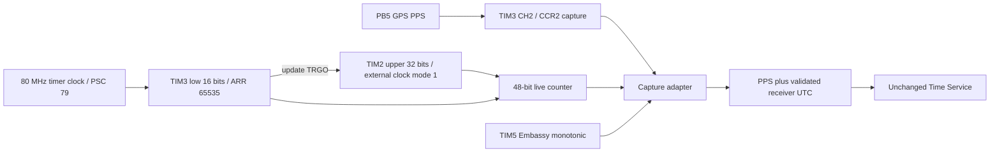

# ADR-L4-009: Chained PPS capture and shared UTC discipline on Evo

## Status

Accepted for implementation, 2026-11-24. Target:
[`unitsmokeL4/04_timing`](../../../unitsmokeL4/04_timing/README.md).
Its [evidence record](../../../unitsmokeL4/04_timing/evidence/README.md)
distinguishes implemented behavior from bench results.

## Context

[L4-008](ADR-L4-008-gps-uart-fix-pps.md) established the fitted Quescan G10A-F30's
38400-baud UART, SPG 5.10/protocol 34.10 identity, fixes and PB5 PPS. Its EXTI
timestamps were sufficient for signal continuity, not precise drift correction.
PB5 is TIM3_CH2 AF2 on the STM32L476RG. TIM3 has only a 16-bit counter; a 1 MHz
counter wraps every 65.536 ms. Counting those wraps in an ISR is unnecessary
when a free timer can count the carries in hardware.

## Decision

Add an isolated L4 leaf, retaining the root U5 defaults and all upstream code,
fixtures and test expectations. Reuse `raylar-time-service` directly, including
its default `TimeConfig`, estimator, phase slew, cadence admission, calibration,
holdover and reacquisition behavior. Keep the new capture adapter local to this
smoke until board-wide peripheral allocation is decided. Do not clone the
estimator or shorten its calibration window to produce a quick bench pass.

### Counter arrangement



The routing and external-clock arrangement are explicitly described in
[ST RM0351 Rev 10, section 31.3.15, timer synchronization](https://www.st.com/resource/en/reference_manual/rm0351-stm32l47xxx-stm32l48xxx-stm32l49xxx-and-stm32l4axxx-advanced-armbased-32bit-mcus-stmicroelectronics.pdf):
TIM3 update TRGO (`MMS=010`) feeds TIM2 ITR2 (`TS=010`) with external clock mode
1 (`SMS=0111`). TIM2 counts TIM3 carries, using PSC=0 and ARR=`0xffffffff`.
TIM3 uses PSC=79, ARR=`0xffff`, up-counting and rising-edge direct TI2 capture.
Both timers use the verified 80 MHz APB1 timer clock. Configure/load prescalers
before connecting the carry route, initialize both counts, enable the slave,
then start the master. Setup update events must not become an unintended carry.

| Resource | Owner and purpose |
| --- | --- |
| TIM3 / PB5 AF2 | Low counter and CCR2 PPS capture; custom capture IRQ at highest priority. |
| TIM2 | Upper 32-bit hardware carry counter; no interrupts enabled. |
| TIM5 | Existing Embassy 1 MHz monotonic driver; no replacement or frequency adjustment. |
| USART2 PA2/PA3 | 38400, 8N1; interrupt-buffered RX/TX, using the profile verified in 03. |
| DMA | None required. All carry counting is internal timer hardware. |
| PB4 | Input/no pull; preserve the powered receiver and unverified enable semantics. |
| SRAM1 | Statics and ordinary CPU stack; link-time minimum 24 KiB gap. No heap. |

The combined count is `(TIM2.CNT << 16) | TIM3.CNT`: 48 bits at 1 MHz, about
8.9 years before a complete wrap. Disable TIM3 update interrupts and all TIM2
interrupts. Production TIM3 interrupts occur only on PPS capture, approximately
once per second. Keep timer IRQ, error, queue and capture-latency counters.

### Capturing a coherent extended value

CCR2 latches **only the low word**. The chain does not create an atomic 48-bit
capture register. The IRQ reads a coherent live high/low/high snapshot, retries
if the high word changes, and avoids an eight-microsecond aperture on either
side of a low-word carry so propagation has settled. If CCR2 is greater than
the current low count, use the preceding high word. Otherwise use the current
high word. Arithmetic is modulo 48 bits for the startup rollover test.

This reconstruction requires service before another full low-word period:
**interrupt latency must remain below 65.536 ms**. The IRQ has highest priority,
does no formatting/logging/allocation, and queues a small capture record.
The diagnostic rejects overcapture, queue overflow, incoherent snapshots and
an observed modulo capture age over 10 ms. It also requires clean one-second
capture intervals. These checks do not prove the latency bound under an
arbitrary interrupt blackout: a delay of one complete low period can alias.
Do not claim arbitrary-blackout-safe 48-bit capture from this adapter.

The cooperative firmware has no long interrupt-masked operation. A production
port must audit worst-case masking/IRQ latency under SD/audio load. If it cannot
meet this bound, add a verified hardware/DMA high-word snapshot or another
capture arrangement. A software overflow ISR remains an alternative; it is not
used or silently substituted by this test.

Map the capture domain to TIM5 with a startup bracket: read Embassy time,
the coherent live count, then Embassy time again. Accept a bracket no wider
than four microseconds; use its midpoint as the epoch and conservatively include
half its span plus two microseconds in anchor uncertainty. Both counters then
advance at the same HSE-derived nominal 1 MHz. Later PPS timestamps come from
the captured count plus that fixed offset, not IRQ/task wake-up times.
Freeze TIM2, TIM3 and TIM5 together during a debugger halt. Validate through an
attached reset run, without mid-test attach, clock reconfiguration or sleep.

### Startup and native checks

Before enabling real PB5 capture or admitting UTC:

1. Configure input capture, enable the channel and keep PB5 disconnected from
   the timer and NVIC disabled during synthetic tests.
2. Generate a software capture with the counter stopped at a known low word.
   Start the counter and read after approximately 100 microseconds. Exercise a
   normal low value, a low-word carry, and upper-word rollover from `0xffffffff`
   to zero. Require exact reconstruction of the seeded captured count.
3. Reset both counts, clear synthetic flags, establish the TIM5 bracket, then
   connect PB5 AF2 and enable only CC2IE. Synthetic captures never enter UTC.

Native tests cover every low-word value with several sub-period service delays,
the 48-bit boundary, stale/future labels, duplicate labels, skipped sentences
and inconsistent UTC/sequence increments. Real PPS must still prove the physical
AF2 input, timer IRQ and carry route on the connected unit.

### UTC association and the upstream service boundary

Reuse the bounded, checksum-valid mixed NMEA/UBX decoder from 03 as a portable
library dependency, with its firmware feature disabled. Reuse the upstream
portable NMEA parser and UTC date conversion. Poll MON-VER and NAV-PVT without
changing receiver settings; require fresh qualified NAV-PVT with valid, fully
resolved UTC before admitting dated active RMC fixes.

Match RMC to the preceding captured PPS only inside the upstream 750 ms serial
window. Admit one label per PPS sequence, and require equal UTC-second and PPS
sequence increments across subsequent labels, including skipped sentences.
Serial arrival is used only for freshness, never as the UTC anchor timestamp.
As in the existing receiver pipeline, absolute initial second association
depends on the receiver's UTC-message semantics; this is not an independent UTC
traceability test or a leap-second qualification.

Send the public `Anchor` type directly to `TimeResources`: source `GpsPps`,
the mapped hardware timestamp, UTC second, measured cross-clock uncertainty,
raw 48-bit `capture_ticks`, raw sequence and preceding raw PPS interval. Do not
label TIM3 as the existing U5-specific `Tim4Capture` enum variant. The shared
estimator currently uses the hardware-derived system timestamp for its
frequency regression; forwarding `capture_ticks` preserves the existing seam
without claiming a separate raw-count estimator. No shared enum/API change is
needed for this bring-up.

The Time Service remains the only owner of monotonic-to-UTC conversion.
Consumers continue to obtain validity, age and uncertainty from its published
state. The raw Embassy clock is not adjusted. The same calibrated mapping and
phase slew used upstream correct local UTC.

### Bench phases and acceptance

Run with real GPS throughout, allowing up to 1800 seconds for the complete
diagnostic. Print progress at ten-second intervals and detailed capture/anchor
samples sparsely. Fail visibly on clock, capture, UART, deadline or admission
assertions; leave receiver power and SD contents untouched.

1. **Calibration:** use the unmodified TimeConfig. Collect eleven frequency
   samples separated by at least sixty local seconds. An oscillator that runs
   slightly slow can need 61 GPS seconds between samples. Require the actual
   `frequency_calibration_locked` state, not elapsed time alone. Record rate
   correction, residual, uncertainty and accepted/rejected counts.
2. **Holdover:** withhold anchors for sixty receiver UTC seconds while continuing
   raw capture and UART validation. The receiver remains on; this is a source
   gate test, not receiver power-loss recovery. Require no newly accepted
   anchors, retained calibration and published holdover duration. Compare raw
   system elapsed time and the service's corrected elapsed time against GPS.
   Require corrected elapsed error at most 50 microseconds, and no greater than
   one quarter of raw error plus ten microseconds.
3. **Anchor resumption:** resume real anchors through unchanged upstream
   admission. Require twenty further accepted anchors, an inactive gate, no
   UTC-second corrections and current absolute residual within 50 microseconds.
   Because raw PPS intervals and sequence remain continuous, the service treats
   withheld UTC labels as skipped correlations and need not activate its
   five-edge discard gate. Record the actual rejection count rather than
   manufacturing a PPS discontinuity. Publish final PASS, then continue normal
   anchor delivery and diagnostics. The diagnostic phase name `reacquiring`
   refers to the anchor stream; it does not establish physical PPS reacquisition.

Report error differences over holdover separately from absolute phase error.
No phase step is introduced by the leaf: it uses the unchanged service's
continuity behavior. Long-term 30-minute tracking updates, temperature drift,
external UTC accuracy, pulse electrical characteristics, physical PPS-loss
reacquisition and audio/SD contention are outside this initial bench acceptance.

Archive the exact tested ELF/BIN/lockfile, source and tool identity, feature graph,
memory layout, full logs, synthetic checks and actual calibration/holdover results.
Build all existing U5 firmware packages individually; compare effective features
and baseline host test results without changing expectations. Keep 01–03 source
and features unchanged. Do not claim U5 hardware coverage from this L4 run.

## Policy overrides

The shared time policy, calibration parameters and UTC ownership are unchanged.
The holdover source gate deliberately stops delivering all anchors; retained
GPS observations are comparison evidence and do not discipline the service.
Logging/Versioning services and storage are absent; captured RTT and the archived
build record provide lab provenance.

```yaml
policy_overrides:
  - policy: gps
    key: first_search_s
    value: 1800
    reason: One deadline covers acquisition, the full calibration, holdover and reacquisition bench phases.
  - policy: gps
    key: duty_cycle
    value: {minimum_on_s: 1800, standby_s: 0}
    reason: Continuous powered reference during calibration and the deliberate anchor-withholding test.
  - policy: gps
    key: search_timeout
    value: Fail through RTT without driving receiver reset or power.
    reason: Receiver power/standby semantics remain unqualified for this harness.
  - policy: ui
    key: startup.enabled
    value: false
    reason: No buzzer is initialized in this diagnostic.
  - policy: ui
    key: errors.enabled
    value: false
    reason: Panic-probe/RTT reports diagnostic failures; application fault annunciation is absent.
  - policy: ui
    key: gps_green.searching
    value: Off.
    reason: This leaf has no GPS operating-state manager; green pulses only for newly accepted Time Service GPS anchors.
```
