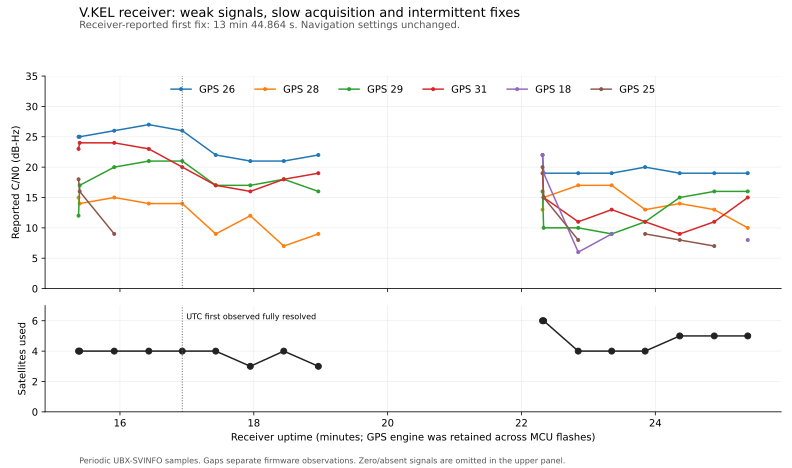

# V.KEL acquisition and receiver diagnostics — 2026-11-26

## Outcome

The receiver confirms the long acquisition: NAV-STATUS reports TTFF **824.864 s
(13 min 44.864 s)**. The V.KEL VK2828U7G5LF identifies as **u-blox 7**, software
`1.00 (59842)`, hardware `00070000`, protocol `14.00`; it is not an M6 in these
tests. Runtime baud discovery at 9600 and configuration to 38400 passed on the
common image. No receiver-generation build flag is needed.

The observations show weak signals, poor four-satellite geometry, intermittent
valid fixes and a later UTC-resolution delay. Receiver settings were read, not
retuned. Two diagnostic runs each closed two complete mono FLAC minutes with
concurrent syslog. The final common image remains running and recording.

The graph contains periodic snapshots, not continuous RF measurements. Its gap
separates firmware observations. Receiver uptime advanced continuously across
the MCU flash; the GPS navigation engine was not reset.

## What was observed

| Observation | Evidence |
| --- | --- |
| Before acquisition | Earlier UART-buffer capture showed one GPS signal around 25–27 dB-Hz, zero satellites used, fix type 0 and provisional UTC validity `0x03`. |
| Receiver-reported first fix | 824864 ms; the same value persisted in both later runs, with receiver uptime progressing from 15.38 to 25.38 minutes. |
| Satellite tracking | GPS signals with positive C/N0 ranged from 6 to 27 dB-Hz across the diagnostic snapshots; 3–6 satellites were used. Code lock and ephemeris flags were logged per satellite. |
| Geometry | GSA reported PDOP around 23–26 with four satellites, with repeated invalid/2D states. At the end of the final run, five satellites were used and NAV-DOP reported PDOP 6.71, HDOP 2.33 and VDOP 6.29. |
| UTC readiness | PVT initially had `valid=0x03`; `0x07` was first observed at receiver age 16.93 minutes. The first run admitted UTC/PPS at firmware time 101.332776 s. Position TTFF and recorder time readiness were different milestones. |
| Retained-state MCU reboot | In the final run, the GPS remained powered through flashing; UART profile readback passed at 0.763042 s and UTC synchronized at 0.988973 s. This is not a receiver backup/wake TTFF measurement. |
| UTC/aiding after acquisition | NAV-TIMEGPS and NAV-TIMEUTC validity `0x07`; AID-HUI flags `0x00000007`, UTC week 2446 and leap-second value 18. |
| Antenna/RF monitor | Antenna status 2 (OK), antenna power 1 (on). AGC/noise/jamming indicators were recorded. The interference monitor is disabled in the readback, so no calibrated “no interference” conclusion follows. |

The adapter still requires fully resolved UTC, a valid 3D fix and at least four
satellites before forwarding NMEA to the shared driver. The shared time service
also qualifies PPS. A flashing PPS LED or a native position fix alone does not
prove that these application conditions have been met. The diagnostic data
explains why the recorder can wait after a receiver first reports a position.

## Configuration readback

| Setting | Measured value |
| --- | --- |
| Dynamic model / fix mode | Portable (`0`); automatic 2D/3D (`3`) |
| Minimum elevation / minimum C/N0 | 5 degrees / 7 dB-Hz |
| Minimum / maximum navigation satellites | 3 / 22; initial 3D-only requirement disabled in the receiver |
| PDOP / TDOP masks | 25.0 / 25.0; raw CFG-NAV5 values 250 use **0.1** scaling |
| Position / time accuracy masks | 100 m / 300 m |
| Additional C/N0 fix threshold | Disabled (threshold satellite count 0) |
| Constellations | GPS, SBAS and QZSS enabled; GLONASS disabled |
| Measurement/navigation rate | 1000 ms / one measurement cycle |
| Low-power mode | 0, continuous operation; PM2 readback is not evidence of active duty cycling |
| Timepulse | One-second period; unlocked pulse length zero, locked length 100000 us; flags `0x000000f7` |
| Other aiding settings | PPP 0, AOP 0; week-rollover reference 1691 |

These values do not show a restrictive elevation/C/N0 setting or an active
power-saving schedule causing the delay. In the first diagnostic ELF the raw
NAV5 mask fields were mislabeled `pdop_centi`/`tdop_centi` in RTT; they were
still raw values 250, meaning 25.0. The final ELF corrects the labels to
`pdop_mask_deci`/`tdop_mask_deci`. PVT and NAV-DOP use separate 0.01 scaling.

## Configuration direction

- **Stationary dynamic model (`2`)** fits this deployment and is the first
  navigation-model change to evaluate. It is not a demonstrated cure for weak
  reception or missing orbit/UTC data.
- **Retain RTC/backup and aiding data** across intended off intervals. The
  retained-state result is encouraging; actual software-backup/wake and BBR
  retention still need their own test.
- **Consider cached/time/position aiding or AssistNow Autonomous**, if supported
  by the receiver variant, for longer off intervals. AOP is currently disabled.
- Keep continuous acquisition and the measured input masks as the baseline.
  Changing the application's 3D/location requirement separately from time
  readiness would be a time-quality design decision, not a receiver tuning fix.

Parameter interpretation and the stationary/RTC/aiding options follow the
[u-blox 7 protocol manual](https://content.u-blox.com/sites/default/files/products/documents/u-blox7-V14_ReceiverDescriptionProtocolSpec_%28GPS.G7-SW-12001%29_Public.pdf).
No dynamic-model, filter, constellation, power or aiding settings were changed
in these runs; only the existing UART transport profile was configured.

## Possible local electrical contribution

The snapshots adjacent to audio hardware initialization show a repeatable
association:

| Run | Before/after firmware time | Matched GPS signals | Median C/N0 change |
| --- | --- | --- | --- |
| `vkel-diag-01` | 94.356 / 124.369 s; audio initialized at 101.510 s | 4 | −4.0 dB |
| `vkel-diag-02` | 0.9446 / 1.9524 s; audio initialized at 1.1660 s | 10 | −4.5 dB |

This suggests testing interference, supply coupling or grounding around audio
and recording startup. It does **not** isolate DFSDM/PDM clocks as the cause:
these were not controlled off/on trials, and other startup activity and RF
conditions can change. A useful next bench experiment holds the powered GPS
and antenna fixed while alternating digital/audio/SD activity, with per-SV C/N0
recorded throughout. Stationary-mode tuning cannot establish this cause.

## Recording, timing and code validation

`vkel-diag-01` (diagnostic revision 3) passed two closes: 1029096 and 1029939
bytes, each 960000 samples. UTC later degraded during holdover when valid 3D
anchors stopped; only seven anchors had been accepted at the last health line.
This was a recording-path pass, not a claim of sustained GNSS quality.

`vkel-diag-02` (final revision 4) also passed two closes:

| File | Close time | Bytes | Samples | Normalized checksum |
| --- | --- | --- | --- | --- |
| 1 | 122.864537 s | 1031192 | 960000 | `35080d19` |
| 2 | 182.863693 s | 1031559 | 960000 | `c91bddce` |

The third file opened normally. At 180 seconds, syslog had written 31833 bytes,
70 time anchors had been accepted, and seven had been rejected during startup
reacquisition. The PPS gate cleared at 15.915400 seconds; the rejected count did
not increase after the 20-second health line. Drift regression reached three
samples and +8856 ppb; the full initial calibration was not locked. The full
recording CPU window was 27.0%, with zero logged message drops, truncations or
write errors, no audio/storage fault, and an intact stack guard. The files were
not independently decoded/read back in this continuous run.

The final image is `target/l4-gnss-auto/aardwolf-l4-autodetect-v4.elf`, SHA-256
`acf6c0086e6821770e3371352ab132ed744d938ca0c490ff90a79c34b4927621`.
Flash sections total 273060 bytes; SRAM1 static sections total 96796 bytes,
leaving 1508 of 98304 bytes. Source/ELF identity and the linker limits passed.
Existing L4/board host tests passed (25), as did shared u-blox tests (7) and U5
Aardwolf host tests (6). U5 sources and the shared estimator/driver were not
changed. The added capture timeout permits longer cold-start observations.

Raw logs/build metadata are retained locally in
`evidence/20261126-gnss-auto/`. This includes `vkel-diag-01/02.{log,json}`,
`acquisition-summary.json`, `acquisition-events.json` and
`satellite-tracking.csv`. The raw evidence directory is ignored by Git. The
monitor detached cleanly; the final image was left recording. M10
reconfirmation on the revised image, the earlier M8 PPS issue and full receiver
sleep/wake qualification remain separate outstanding hardware checks.
