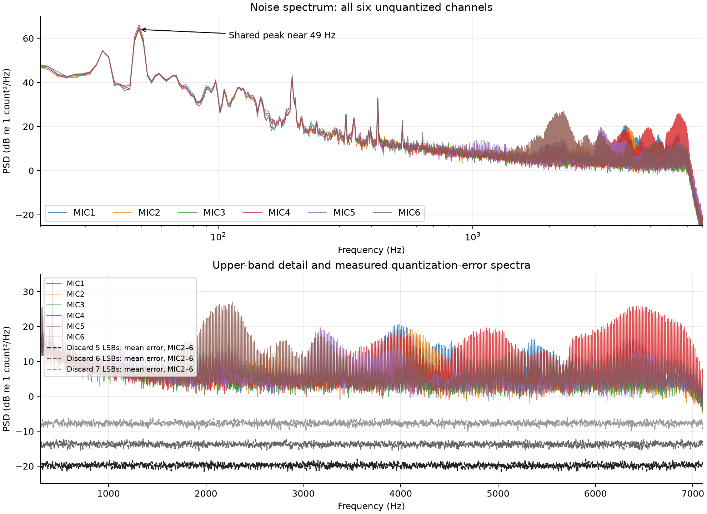
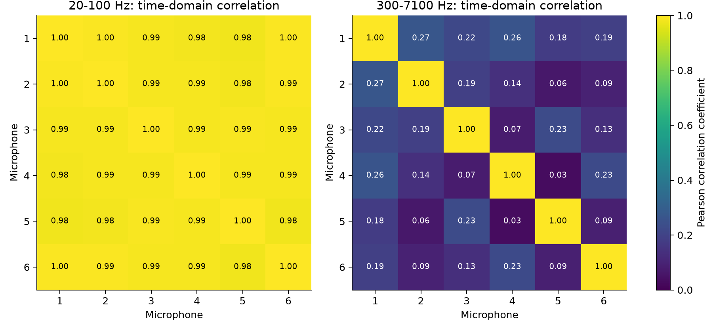
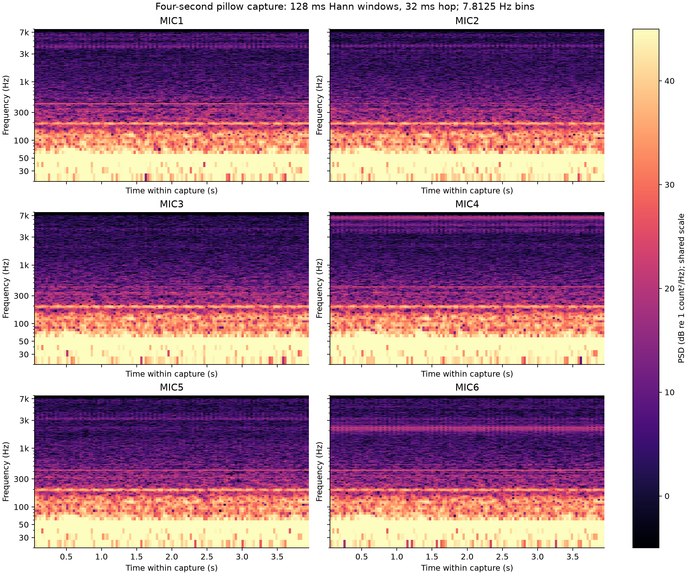
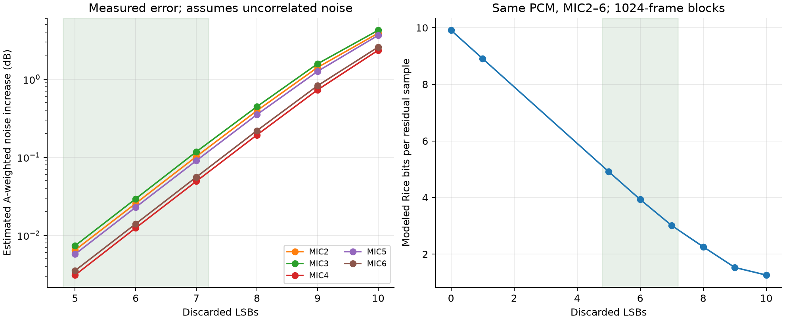

# Analysis 001: microphone noise, useful precision and multichannel compression

**Date:** 15 October 2026  
**Hardware:** Raylar v1.0, STM32U595, six IM69D129FV01 PDM microphones  
**Purpose:** justify removing 5–7 least-significant bits (LSBs) from MIC2–MIC6 before temporal prediction and Rice coding. MIC1 remains the lossless reference.

## 1. Design conclusion

The datasheet calculation and an unquantized six-microphone hardware capture support **5–7 discarded LSBs as a sensible precision range to evaluate**, with **6 LSBs as the starting setting**. These are absolute shifts of the recorder's right-justified PCM values. They are not 5–7 bits retained per sample, nor an extra shift applied after existing block quantization.

- The nominal datasheet self-noise maps to approximately **170 stored counts RMS, A-weighted**, or `log2(RMS) ≈ 7.4` with the current MDF gain.
- A four-second pillow-covered board capture measured **219–337 counts RMS, A-weighted**, equivalent to **7.8–8.4 bits**. This includes the environment and board; it does not isolate microphone self-noise.
- On those exact samples, discarding **5, 6 or 7 LSBs** gives estimated additional A-weighted noise of **0.003–0.007, 0.012–0.029 or 0.049–0.118 dB**, respectively, across the five additional channels.
- A same-input Rice residual model predicts approximately **4.92, 3.93 or 3.01 bits per residual** for these settings, versus **8.91** for a lossless baseline that removes the one already-zero bit observed in this capture. This is a modeled coding benefit, not a measured CRCL file-size or energy reduction.

The evidence supports reducing precision used to represent low-order variation. It does not establish that every discarded bit contains only noise, or that beamforming and angle-of-arrival (AoA) accuracy are unchanged. Frequency-specific error and downstream performance remain relevant, especially at seven discarded bits.

## 2. Sample units and the meaning of a noise-floor “bit count”

The MDF provides left-aligned 24-bit output in a 32-bit DMA word. The application's [capture publication code](../../../apps/aardwolf/audio.rs) performs:

```rust
let pcm = (dma_word as i32) >> 8;
```

The stored signed `i32` therefore holds a **right-justified signed-24-bit value**. Its upper eight bits are sign extension; a FLAC32 container does not give the microphone another eight bits of precision. The hardware unpacking above is already part of normal recording and is separate from the proposed lossy shift.

Throughout this report, one **count** is one unit of that unpacked PCM value. Define:

$$
B_{\mathrm{noise}}=\log_2(\sigma),
$$

where $\sigma$ is noise RMS in counts. This locates the RMS magnitude on a binary scale. It is **not** ENOB, a count of wholly meaningless bits, or a threshold below which acoustic information disappears. Noise and useful signals overlap.

Two full-scale references must also be kept separate:

| Reference | Definition used here |
| --- | --- |
| Microphone-input dBFS | Normalized PDM signal, with a full-scale sine of peak amplitude 1 and RMS $1/\sqrt{2}$. Used to interpret microphone sensitivity. |
| Stored-sample dBFS24 | RMS referenced to $2^{23}/\sqrt{2}\approx5.932\times10^6$ counts, the RMS of a full-scale signed-24-bit sine. |

The MDF gain connects these references. They are not interchangeable, and neither uses the full signed-32-bit range as its reference.

## 3. Datasheet expectations

### 3.1 Microphone sensitivity and self-noise

The [Infineon IM69D129F datasheet, version 1.0](https://www.infineon.com/assets/row/public/documents/24/49/infineon-im69d129f-datasheet-en.pdf), identifies the device variant as IM69D129FV01. Relevant specifications are:

| Parameter | Datasheet value / condition |
| --- | --- |
| Sensitivity | −36 dBFS typical; −37 to −35 dBFS; 1 kHz, 94 dB SPL |
| SNR | 69 dB(A) typical at 3.072 MHz PDM clock |
| Acoustic overload point | 129 dB SPL at 10% THD |
| High-performance clock range | 2.9–3.4 MHz |
| Acoustic test conditions | 1.8 V, OSR 64, 20 Hz–20 kHz, unless otherwise specified |

Our 3.2 MHz clock falls in that operating range, but 69 dB(A) is a typical figure at the specified test clock, not a guaranteed minimum at our exact configuration. The sensitivity tolerance, actual acoustic installation and noise distribution introduce uncertainty.

The inferred microphone self-noise is:

$$
N_{\mathrm{mic,A}}=-36-69=\mathbf{-105\ dBFS(A)}.
$$

The corresponding equivalent acoustic self-noise is approximately $94-69=\mathbf{25\ dB\ SPL(A)}$. The 69 dB SNR is relative to a 94 dB SPL test signal; it must not be mistaken for the entire full-scale dynamic range.

### 3.2 Active MDF chain

The [high-performance preset](../../../crates/drivers/src/mic_array/mod.rs) and [STM32 implementation](../../../crates/drivers/src/mic_array/stm32.rs) configure:

| Stage | Setting | Consequence |
| --- | --- | --- |
| MDF kernel | PLL3-Q, 96 MHz | Clock source |
| PDM clock | $96\text{ MHz}/(2\times15)=3.2\text{ MHz}$ | High-performance microphone operation |
| CIC | Sinc5, decimation 50 | Output rate 64 kHz; low-frequency gain $50^5$ |
| SCALE | `0x27`, approximately −26.6 dB | Attenuates the CIC output |
| Reshape filter | Enabled, decimation 4 | Output rate 16 kHz; approximately +9.3 dB gain |
| High-pass filter | Enabled, cutoff approximately 10 Hz | Suppresses DC and very low frequencies |
| Output | 24-bit, packed in 32-bit DMA words | Unpacked by arithmetic `>> 8` |

[ST AN5795, “Multirate filter basics”](https://www.st.com/content/st_com/en/technical-documents/an5795-how-to-use-multifunction-digital-filter-mdf-to-capture-sound-on-stm32-mcus-stmicroelectronics_asset/chunk-001-topic-an5795-multirate-filter-basics.html) gives the CIC gain $R^N$ and the HPF cutoff choices. Its [“RSFLT frequency response” section](https://www.st.com/content/st_com/en/technical-documents/an5795-how-to-use-multifunction-digital-filter-mdf-to-capture-sound-on-stm32-mcus-stmicroelectronics_asset/chunk-002-topic-an5795-rsflt-frequency-response.html) documents approximately 9.3 dB reshape gain and a 7.1 kHz passband when the reshape input is 64 kHz.

Ignoring small passband ripple and taking the HPF gain as approximately unity away from its cutoff, the count gain is:

$$
\begin{aligned}
G_{\mathrm{CIC}}&=50^5=312{,}500{,}000,\\
G_{\mathrm{SCALE}}&\approx10^{-26.6/20}=0.0468,\\
G_{\mathrm{RSFLT}}&\approx10^{9.3/20}=2.92,\\
G_{\mathrm{counts}}&\approx G_{\mathrm{CIC}}G_{\mathrm{SCALE}}G_{\mathrm{RSFLT}}
\approx\mathbf{4.27\times10^7}.
\end{aligned}
$$

Thus the complete chain has approximately **+14.1 dB gain relative to a unity-normalized signed-24-bit mapping**. Applying −26.6 dB to the microphone noise figure without accounting for CIC and reshape gain would be incorrect. The numeric gains are approximate because the documentation rounds them in dB.

This is a small-signal, unclipped calculation. ST documents a full-scale Sinc5 CIC decimation limit of 32; larger ratios can be used for reduced input amplitudes. Our R50 preset bypasses the driver's ordinary full-scale width check. The present quiet capture does not validate loud-signal headroom, and SCALE attenuation after the CIC cannot repair upstream overflow. This affects headroom qualification, rather than the low-level noise calculation.

### 3.3 Expected noise in stored counts

Using the full-scale-sine convention:

$$
\sigma_{\mathrm{A,nominal}}
\approx\frac{G_{\mathrm{counts}}}{\sqrt{2}}10^{-105/20}
\approx\mathbf{170\ counts\ RMS},
\qquad \log_2(170)\approx\mathbf{7.4}.
$$

As a cross-check, the 94 dB SPL sensitivity maps to approximately 677,000 counts peak, or 479,000 RMS. Dividing that RMS by $10^{69/20}$ again gives approximately 170 counts. The corresponding nominal stored level is approximately **−90.9 dBFS24(A)**.

At 16 kHz we retain less bandwidth than the microphone's 20 kHz specification. A rough reading/integration of the typical unweighted noise-density curve in datasheet Figure 8, with our approximately 10 Hz HPF and 7.1 kHz passband, previously suggested **350–450 counts RMS**, or **8.5–8.8 bits**, unweighted. This is an order-of-magnitude estimate: it is not a bit-accurate PDM/MDF simulation, and its low-frequency portion is particularly uncertain. The nominal 170-count A-weighted result also should not be presented as an exact prediction of our narrower-band RMS. A rough integration suggests approximately 145 counts A-weighted over the retained band.

For comparison, a unity-normalized 24-bit calculation would give:

$$
\frac{2^{23}}{\sqrt{2}}10^{-105/20}\approx33\text{ counts},
\quad \log_2(33)\approx5.1.
$$

That explains a possible “about five noise bits” estimate, but it omits our actual MDF gain. The expected floor in the **current stored units** is higher.

## 4. Hardware experiment

### 4.1 Capture and integrity

The user placed the connected board between two pillows to reduce ambient sound. The [noise-floor diagnostic](../../../servicetests/crclencoder/noise_floor.rs) used the production microphone preset, discarded two seconds of startup and captured four continuous seconds from all six channels directly into RAM.

| Property | Observed configuration / result |
| --- | --- |
| Samples | 64,000 per microphone, 384,000 total scalar samples |
| Representation | Interleaved little-endian i32; normal hardware unpacking only |
| Source continuity | DMA sequences 21–60 inclusive; no gaps or reported capture error |
| Processing during capture | No CRCL or FLAC encoding; no lossy scaling or quantization |
| Other tasks | GPS, SD recording and radio tasks not started |
| Core supply | HAL default; not Aardwolf's explicit SMPS selection |
| RAM readback | 1,536,000 bytes; all six integer sums, squared sums, minima and maxima match target-side summaries |
| Sample limits | Largest absolute sample 14,016 counts; no observed output clipping |
| Bit occupancy | Every captured sample has bit 0 equal to zero |

The already-zero bit is an observation of this capture, not a promise that bit 0 is always zero under every MDF configuration. The application image was preserved and restored with flash verification after the experiment.

This measures **microphone + board + remaining environment noise**. Pillows are neither an acoustic calibration chamber nor electrical shielding. The short record also excludes production SD/radio concurrency and does not reproduce the explicit production supply setting.

### 4.2 Analysis method

Full-band AC RMS uses all 64,000 samples after subtracting each channel's overall mean. Spectral estimates use one-sided Welch PSD, Hann windows of 8192 samples, 4096 overlap and constant detrending: approximately **1.95 Hz bins**, with 14 overlapping windows. Band powers are integrals of that PSD, with interpolation at band boundaries. The weighted figures integrate squared A-weighting amplitude over **20 Hz–7.1 kHz**.

Full-band time-domain RMS and band-limited Welch estimates are intentionally separate measures; finite-record/window effects and very low-frequency energy mean their values need not match. A-weighting is useful for comparison with the datasheet but does not represent the frequency weighting of a beamformer.

### 4.3 Measured levels

All RMS columns below are in recorder PCM counts.

| MIC | Full-band AC RMS | log2(full-band RMS) | 20 Hz–7.1 kHz RMS | A-weighted RMS, same band | log2(A-weighted RMS) | dBFS24(A) |
| --- | ---: | ---: | ---: | ---: | ---: | ---: |
| 1, reference | 3683 | 11.85 | 3068 | 259 | 8.02 | −87.19 |
| 2 | 3767 | 11.88 | 3096 | 234 | 7.87 | −88.09 |
| 3 | 3826 | 11.90 | 3150 | 219 | 7.77 | −88.67 |
| 4 | 4332 | 12.08 | 3795 | 337 | 8.40 | −84.91 |
| 5 | 4003 | 11.97 | 3355 | 249 | 7.96 | −87.56 |
| 6 | 3933 | 11.94 | 3352 | 316 | 8.30 | −85.47 |

Measured A-weighted levels are approximately **2.2–6.0 dB above** the nominal 170-count estimate, or approximately 3.6–7.4 dB above the rough narrower-band estimate. Given the remaining interference and different test conditions, this is compatible with the expected order of magnitude; it is not a validation of the exact microphone self-noise specification.



*Figure 1. Measured PSD. The upper panel shows the dominant common low-frequency component; the lower panel exposes quieter frequencies and overlays actual quantization-error spectra, averaged across MIC2–MIC6. The vertical units are power density in stored-count units, not dBFS or sound pressure.*

### 4.4 Frequency distribution and common interference

| MIC | 20–100 Hz RMS | 100–300 Hz RMS | 300 Hz–1 kHz RMS | 1–3 kHz RMS | 3–7.1 kHz RMS |
| --- | ---: | ---: | ---: | ---: | ---: |
| 1 | 3027 | 435 | 143 | 91 | 166 |
| 2 | 3059 | 435 | 114 | 91 | 134 |
| 3 | 3111 | 462 | 117 | 87 | 109 |
| 4 | 3756 | 445 | 119 | 86 | 274 |
| 5 | 3314 | 475 | 131 | 99 | 136 |
| 6 | 3314 | 422 | 135 | 203 | 134 |

Approximately **97.4–98.0% of the measured 20 Hz–7.1 kHz power is below 100 Hz**. All six Welch spectra peak at 48.83 Hz. That is the spectral-bin location, not a precision identification of the physical source. A mains-related component is plausible, but this experiment cannot distinguish electrical pickup, acoustic hum, mechanical vibration or another shared source.

After fourth-order Butterworth bandpass filtering with forward/backward application and trimming 100 ms from both ends, interchannel time-domain correlations are **0.978–0.995 at 20–100 Hz**, versus **0.035–0.266 at 300 Hz–7.1 kHz**. The low-frequency component is strongly shared; the quieter upper band is much less correlated. Correlation is not a calibrated separation of acoustic signal from self-noise.



*Figure 2. Pearson correlations between the band-filtered channels. Independent microphone self-noise alone would not explain the near-unity low-band correlation.*



*Figure 3. Shared color scale and logarithmic frequency axes. Spectrograms use 2048-sample Hann windows, 1536 overlap, 128 ms window duration, 32 ms hop and 7.8125 Hz bin spacing. The low-frequency peak saturates the chosen upper color limit to keep quieter structure visible. Upper-band humps vary by channel; the four-second record cannot establish their origin or long-term stability.*

The approximately **12-bit broadband RMS is therefore not a justification to discard 12 LSBs**. It is largely set by low frequencies that say little about the available noise margin at, for example, 2–6 kHz.

## 5. Quantization error for 5–7 discarded LSBs

### 5.1 Operation and computational cost

For an absolute shift $s$, let $\Delta=2^s$. Match the cheap CRCL rounding convention, nearest with ties towards positive infinity:

```rust
// Input is the bounded, unpacked microphone PCM, not arbitrary full-range i32.
let q = (pcm + (1_i32 << (s - 1))) >> s; // s is 5, 6 or 7
// Decoder, after reversing temporal prediction:
let reconstructed_pcm = q << s;
```

The encoder can overwrite each additional channel's sample with `q` in its existing block. Only native i32 addition/shifting and scalar state are required; **no extra sample buffer or i64 promotion is needed** under the established microphone bound. The maximum rounding increment here is 64 counts, far inside that bound's arithmetic headroom. Retain the validated bound and use signed arithmetic shifts.

MIC1 is left unchanged. Temporal prediction follows quantization and operates on each channel's own quantized samples, with per-channel/per-block Rice parameters. The decoder restores the absolute sample lattice using the stored shift. No samples are removed, so timing and reference alignment are preserved.

### 5.2 Error model and measured error

Rounded quantization bounds reconstruction error by $\Delta/2$. For a sufficiently busy input, the usual approximately uniform-error model gives:

$$
\sigma_q\approx\frac{\Delta}{\sqrt{12}},
\qquad
\Delta N=10\log_{10}\left(1+\frac{\sigma_q^2}{\sigma_n^2}\right).
$$

For a weighted or frequency-limited result, both variances must use that same weighting/band. The following increases use **measured error PSDs from the same captured PCM**, not merely the uniform-error approximation. They assume quantization error is uncorrelated with existing noise; they are not measurements of a physically separable noise source or of AoA error.

| Discarded LSBs | Step, counts | Maximum absolute error, counts | Ideal full-band error RMS | Measured full-band error RMS, MIC2–6 | Estimated A-weighted noise increase, MIC2–6 |
| --- | ---: | ---: | ---: | ---: | ---: |
| **5** | **32** | **16** | **9.24** | **9.26–9.30** | **0.0031–0.0073 dB** |
| **6** | **64** | **32** | **18.48** | **18.45–18.54** | **0.0124–0.0293 dB** |
| **7** | **128** | **64** | **36.95** | **36.87–37.05** | **0.0491–0.1176 dB** |
| 8, comparison | 256 | 128 | 73.90 | 73.73–74.03 | 0.193–0.445 dB |
| 9, comparison | 512 | 256 | 147.80 | 147.50–147.89 | 0.731–1.577 dB |
| 10, comparison | 1024 | 512 | 295.60 | 294.59–297.29 | 2.351–4.241 dB |

At six discarded bits, the added full-band quantization RMS is approximately **19 dB below** the nominal 170-count datasheet noise estimate; at seven bits, approximately **13 dB below**. The two RMS values use different weighting conventions, so these ratios are a scale comparison rather than a weighted degradation calculation.

To avoid relying only on A-weighted totals, the maximum modeled increase across MIC2–MIC6 in selected quieter bands is:

| Discarded LSBs | 300 Hz–1 kHz | 1–3 kHz | 3–7.1 kHz |
| --- | ---: | ---: | ---: |
| 5 | 0.0025 dB | 0.0127 dB | 0.0160 dB |
| 6 | 0.0103 dB | 0.0502 dB | 0.0637 dB |
| 7 | 0.0385 dB | 0.1975 dB | 0.2497 dB |

Seven discarded bits are therefore more consequential in the upper band than the global A-weighted figure alone suggests. Narrower spectral regions can have different margins again. This supports a six-bit starting point, with five for additional precision margin and seven as a controlled rate/quality experiment.

## 6. Why this should improve compressibility

The low-order signal contains microphone self-noise, residual PDM conversion/filter noise and environmental/electrical contributions. Independent, unpredictable variation is expensive to encode losslessly. These observations do **not** show that all of the noise was generated by CRCL quantization. Spatial subtraction cannot cancel independent microphone noise, and temporal prediction cannot fully predict its upper-frequency components.

The strong smooth low-frequency component is already predictable: the measured first-difference RMS is only **199–503 counts** across the six microphones, despite approximately 3700–4300-count full-band RMS. Absolute rounding before temporal differencing reduces the residual precision that still must be represented.

For a same-input comparison, the host model applies each candidate absolute shift to MIC2–MIC6, splits the data into 1024-frame blocks, differences successive quantized samples and folds signed residuals:

$$
u(r)=\begin{cases}2r&r\ge0\\-2r-1&r<0,\end{cases}
\qquad
k=\left\lfloor\log_2\left(\left\lceil\operatorname{mean}(u)\right\rceil\right)\right\rfloor,
$$

with $k=0$ for an all-zero residual block. This matches the cheap encoder's [Rice estimate](../../../crates/services/crclencoder/src/cheap.rs). Each Rice word costs $(u\mathbin{\gg}k)+1+k$ bits. The model includes the partial final block and counts **residual words only**; it excludes first-sample anchors, byte padding, container metadata and the reference file.

| Absolute discarded LSBs | Mean modeled Rice bits/residual | Reduction from observed lossless shift-1 baseline |
| --- | ---: | ---: |
| 0 | 9.910 | — |
| 1, already-zero bit in this capture | 8.910 | 0% |
| **5** | **4.916** | **44.8%** |
| **6** | **3.932** | **55.9%** |
| **7** | **3.012** | **66.2%** |
| 8, comparison | 2.259 | 74.7% |

Removing the observed zero LSB first gives a more meaningful lossless comparison than claiming that its removal is an acoustic trade-off. The 5–7-bit candidates remove another four to six bits of residual precision and produce substantial modeled savings on this input.



*Figure 4. Left: per-channel added A-weighted noise estimate. Right: Rice residual-word cost. Green shading identifies the proposed 5–7-bit range. The noise axis is logarithmic. These are analyses of one shared input, not new hardware recordings at each setting.*

These percentages must **not** be applied directly to current CRCL file sizes or SD energy. The existing block quantizer already chooses a shift from block peak and retained precision. With the current 10-bit target, a peak of 14,016 counts needs approximately a five-bit shift to fit the signed quantizer range. A six-bit minimum may therefore change some blocks by only one bit, rather than adding the whole benefit shown relative to the lossless baseline. Existing encoding, CPU activity, buffering and physical SD writes require a separate end-to-end comparison.

## 7. Applying the result to the design

Use a named **absolute noise-floor shift** for the five additional channels, initially six, with five and seven available for comparison. Keep MIC1 lossless in its existing representation.

Where peak-based block scaling remains, a candidate policy is:

$$
s_{\mathrm{effective}}=\max(s_{\mathrm{peak}},s_{\mathrm{noise}}).
$$

This prevents quiet blocks from using unnecessarily fine precision to encode low-order noise. It combines the shifts into one quantization; do not apply a second lossy rounding pass after the existing quantizer. Store the effective per-channel/per-block shift so reconstruction remains unambiguous.

However, `max` is a **minimum coarseness policy**, not a guarantee that only 5–7 bits are discarded. A loud block or a small retained-bit target may require a larger peak-based shift. If the design intends a hard maximum of seven discarded bits, it must instead permit enough retained bits or provide another representation for blocks that cannot fit. The current fixed retained-bit options and this noise-floor proposal should be reconciled explicitly during implementation.

The proposed in-place add/shift has low computational and memory cost. The capture buffer, floating-point PSD analysis and wide statistical accumulators used in this investigation are diagnostic/host tooling; none is required in the production audio path. This report proposes a precision policy and does not itself change the production codec configuration or CRCL format.

Before treating seven bits as a deployment setting, compare beamforming/AoA on identical representative source recordings at shifts five, six and seven, including weak signals and the intended processing bands. A longer quiet capture with production SMPS, SD and radio activity would also refine the margin. The present evidence is enough to motivate the 5–7-bit design range and six-bit starting point; it does not replace those acoustic and system-level checks.

## 8. Evidence and reproduction

The report includes a portable [losslessly compressed PCM archive](analysis001/pillow-20261015.npz), containing a `(64000, 6)` integer array and the sample rate. Reconstructing its interleaved little-endian i32 bytes must give SHA-256:

```text
09aabf72e4ef26444c019dd2a83df085a131f69d565f80ed78e52ce17605b011
```

| Evidence | Location |
| --- | --- |
| Original target measurements and DMA continuity | [Capture log](analysis001/capture-target.log) |
| Capture build identity | [Build record](analysis001/capture-build.json) |
| Original six-channel analysis | [Capture summary JSON](analysis001/capture-summary.json) |
| Band powers, correlation, quantization and Rice model | [Derived metrics JSON](analysis001/derived-metrics.json) |
| Numeric Welch PSD | [Spectrum CSV](analysis001/spectrum.csv) |
| Figure/metric generator | [audio_analysis001_figures.py](../../../scripts/audio_analysis001_figures.py) |
| Original capture/analysis procedure | [Diagnostic README](../../../servicetests/crclencoder/README.md#raw-microphone-noise-diagnostic) |

The capture ELF SHA-256 was `4387b3febf4714e755c13ce175e06f9f2cba13f83f301e142cff746acdbe5c30`. The original target session is `.probe-rs-logs/20261015-112123-service-test-crclencoder-21000/`; its relevant log is preserved beside this report. The large ELF and original raw debugger file remain local under `target/noise-floor/`; the compressed PCM and numeric evidence above do not depend on retaining that directory.

From the repository root, with NumPy, SciPy and Matplotlib installed:

```powershell
rtk proxy python scripts/audio_analysis001_figures.py
```

The generator verifies the raw-byte SHA-256 and every channel's target-side sum, squared sum and extrema before rebuilding figures and metrics from the archived samples. No board is required. The datasheet calculations are approximate analytical calculations described in Section 3, rather than outputs of the figure generator.

## 9. Source references

1. [Infineon IM69D129F datasheet v1.0, 21 February 2025](https://www.infineon.com/assets/row/public/documents/24/49/infineon-im69d129f-datasheet-en.pdf): Figure 8, acoustic specifications and operating clock ranges.
2. [ST AN5795, MDF multirate filter basics](https://www.st.com/content/st_com/en/technical-documents/an5795-how-to-use-multifunction-digital-filter-mdf-to-capture-sound-on-stm32-mcus-stmicroelectronics_asset/chunk-001-topic-an5795-multirate-filter-basics.html): CIC gain/width, scaling and HPF choices.
3. [ST AN5795, reshape response and configuration examples](https://www.st.com/content/st_com/en/technical-documents/an5795-how-to-use-multifunction-digital-filter-mdf-to-capture-sound-on-stm32-mcus-stmicroelectronics_asset/chunk-002-topic-an5795-rsflt-frequency-response.html): reshape gain, passband and CIC amplitude constraints. [Official PDF](https://www.st.com/resource/en/application_note/an5795-how-to-use-multifunction-digital-filter-mdf-to-capture-sound-on-stm32-mcus-stmicroelectronics.pdf).
4. Repository configuration, capture and analysis files linked in the relevant sections; [original hardware observation note](../../../servicetests/crclencoder/noise-floor.md).
