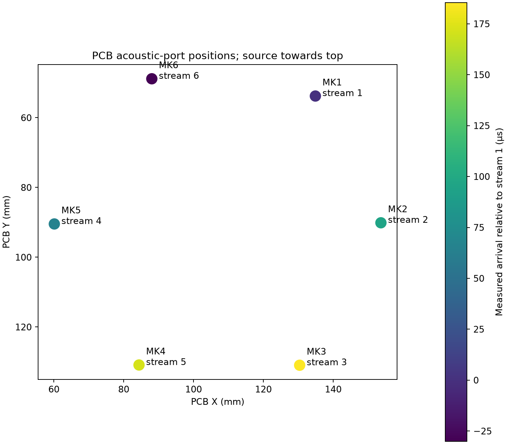
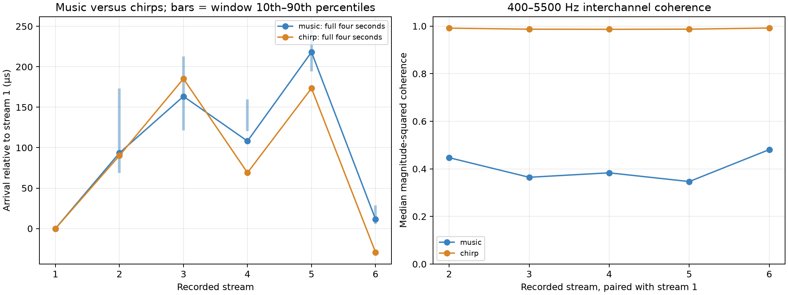
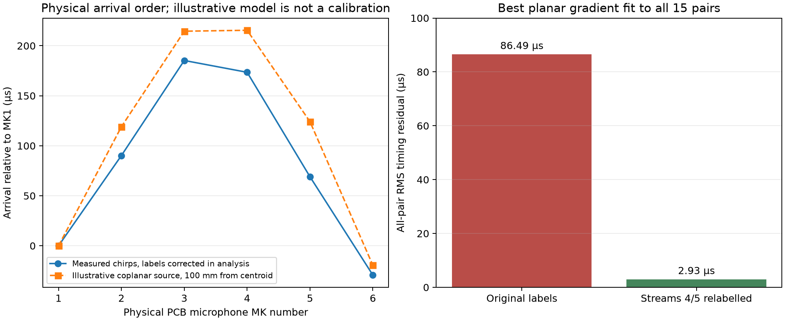
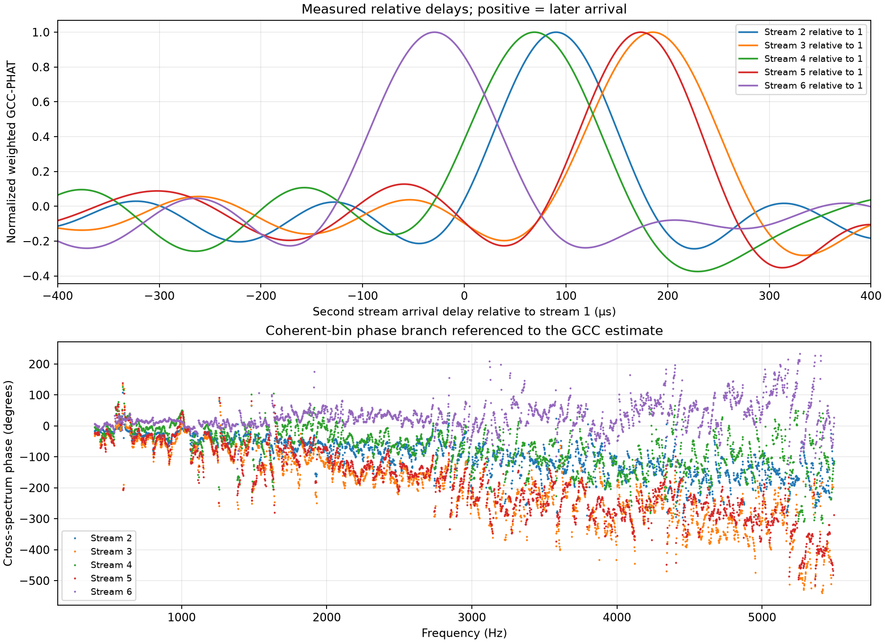

# Analysis 002: six-channel arrival timing, phase and microphone identity

**Date:** 15 October 2026, Europe/London  
**Hardware:** Raylar v1.0, STM32U595, six IM69D129FV01 microphones  
**Related work:** [Analysis 001: noise and useful precision](analysis001.md)  
**Status:** the MIC4/MIC5 selector correction has been implemented in the driver and all-microphone smoke test. The observations below remain from pre-correction captures; this report does not document a post-correction hardware test.

## 1. Findings

The microphone array captures a coherent wavefront, and the observed arrival order agrees with the PCB geometry **once recorded streams 4 and 5 are exchanged in the interpretation**. The current firmware labels those two physical microphones in reverse order.

The user placed a cellphone speaker approximately 10 cm towards the board's top, nominally 0° azimuth. The expected physical order was:

**MK1/MK6 first → MK2/MK5 next → MK3/MK4 last.**

Two four-second raw captures were obtained: first music, then repeated chirps. Both suggested the mapping discrepancy; the chirps provided much stronger evidence:

- Median magnitude-squared coherence across the analyzed band was **0.986–0.992** across the 15 channel pairs, compared with **0.347–0.481** for music.
- Correcting the labels in analysis reduced the chirp all-pair planar timing-fit RMS residual from **86.49 µs to 2.93 µs**.
- Chirp delays relative to stream 1 ranged from **−29.3 µs for stream 6** to **+185.3 µs for stream 3**, consistent with the physical front/middle/back order after relabelling.
- Applying the production cheap-codec quantizer to these same chirp samples changed pair-delay estimates by at most **0.0087 µs**. This is a computed sensitivity comparison, not a timing-accuracy claim.

The experiment supports coherent acquisition and the six-LSB minimum-discard policy for this stimulus. It does **not** establish precise 0° DOA calibration, a frequency-independent phase response, or the integrity of a complete SD-recorded/decoded multichannel segment.

## 2. PCB geometry and channel identity

### 2.1 Source of geometry

Coordinates and microphone nets were extracted from the user's [raylar-HW repository](https://github.com/acmarkham/raylar-HW), pinned to commit:

```text
2bd6c0756970e79749ab685e70b950371fecf959
```

The source is [raylar_v1_00.kicad_pcb at that commit](https://github.com/acmarkham/raylar-HW/blob/2bd6c0756970e79749ab685e70b950371fecf959/v1/KicadProj/raylar_v1_00/raylar_v1_00.kicad_pcb). The extracted [geometry archive](analysis002/geometry.json) includes the source path, PCB SHA-256, footprint rotations and relevant pin nets.

The analysis uses the acoustic through-hole position transformed by each footprint's placement/rotation, rather than only the footprint origin. Coordinates below are in millimetres, with KiCad X increasing to the right and Y increasing downwards. “Physical MK number” means the PCB reference; “stream number” means the position in the captured six-channel sample frame.

| Physical microphone | Acoustic port X | Acoustic port Y | Physical row | DATA net | LR-select net | Observed/inferred stream |
| --- | ---: | ---: | --- | --- | --- | ---: |
| MK1 | 134.880 | 53.789 | Front | MIC_SD0 | 3.3V | 1 |
| MK2 | 153.650 | 90.127 | Middle | MIC_SD1 | GND | 2 |
| MK3 | 130.380 | 130.964 | Back | MIC_SD1 | 3.3V | 3 |
| MK4 | 84.380 | 130.897 | Back | MIC_SD2 | 3.3V | **5** |
| MK5 | 60.128 | 90.464 | Middle | MIC_SD2 | GND | **4** |
| MK6 | 88.043 | 48.839 | Front | MIC_SD3 | 3.3V | 6 |

MK1 has its own MIC_CCLK0 clock net; MK2–MK6 use MIC_CCLK1. The microphone rows are not perfectly symmetric: MK6 is approximately 4.95 mm farther towards the top than MK1. Exact equality within each nominal pair is therefore not expected, even before source-position and near-field effects.



*Figure 1. Acoustic-port coordinates from the PCB, annotated with the stream assignments used during capture. The colors use a common set of arrival times fitted from all 15 pair differences, relative to stream 1. This is a microphone-position diagram, not a rendering of the complete PCB.*

### 2.2 Mapping discrepancy

At capture time, [stm32_config.rs](../../../crates/drivers/src/mic_array/stm32_config.rs) contained:

```rust
// BS0_R, BS1_R, BS1_F, BS2_R, BS2_F, BS3_R.
pub(super) const BITSTREAM_SELECTS: [u32; 6] = [0, 2, 3, 4, 5, 6];
```

On MIC_SD2, the PCB connects MK5's LR pin to GND and MK4's to 3.3V. They occupy opposite PDM lanes. The existing selection assigns the lane associated with MK5 to stream 4, and the lane associated with MK4 to stream 5. This agrees with the acoustic evidence: stream 4 arrives with the middle row, while stream 5 arrives with the back row.

The [IM69D129F datasheet](https://www.infineon.com/assets/row/public/documents/24/49/infineon-im69d129f-datasheet-en.pdf), Table 7, documents the complementary LR-selected data-drive phases. Data-drive edges should not be confused with the receiver's sampling edge: the identity conclusion here combines the PCB nets, MDF lane assignments and measured arrival order.

To align recorded channel numbers with physical MK numbers, the required selector order is:

```rust
// BS0_R, BS1_R, BS1_F, BS2_F, BS2_R, BS3_R.
pub(super) const BITSTREAM_SELECTS: [u32; 6] = [0, 2, 3, 5, 4, 6];
```

**The captures and Aardwolf image restored at the end of this experiment use the original order. The selector correction has since been implemented in source; this evidence remains pre-fix.** Historical recordings made with the original order must be interpreted as streams `[MK1, MK2, MK3, MK5, MK4, MK6]`. Changing the firmware order does not retroactively change those files.

## 3. Experiment and capture integrity

The user initially played music from a cellphone speaker approximately 10 cm from the board, towards its top. A repeated broadband chirp was then requested to improve delay estimation; the suggested sweep was roughly 500 Hz–6 kHz with short gaps. The exact playback waveform, speaker position, height, distance reference and acoustic environment were not independently measured. The source may also have moved between music and chirp playback, so the two recordings should not be treated as an identical-source repeatability experiment.

Both captures reused the [raw noise-floor diagnostic](../../../servicetests/crclencoder/noise_floor.rs). Its log messages retain the `NOISE` prefix even though these were source-playback experiments.

| Property | Both captures |
| --- | --- |
| Settling and recording duration | Two seconds discarded, followed by four continuous seconds recorded |
| Sample count | 64,000 frames per microphone; six channels; 384,000 scalar samples |
| MDF preset | Production high-performance Sinc5/R50; 3.2 MHz PDM; SCALE 0x27; reshape /4; nominal 16 kHz PCM; approximately 10 Hz HPF |
| Sample representation | Unquantized, right-justified signed-24-bit values in interleaved little-endian i32 words; normal `>> 8` unpacking only |
| Source continuity | DMA sequences 21–60, no missing publications or reported capture error |
| Capture processing | No CRCL/FLAC encoding, GPS, SD-recording or radio tasks |
| Supply selection | Diagnostic HAL default, rather than Aardwolf's explicit SMPS selection |
| Readback integrity | Every channel's integer sum, sum of squares, minimum and maximum exactly matched its target-side summary |

Neither capture approached the signed-24-bit output limit. The maximum absolute sample was 63,542 counts for music and 54,062 for chirps. No output clipping was observed; this is not an independent test of every possible internal MDF saturation condition.

The raw-data diagnostic validates the production microphone driver and the captured channel timing. It bypasses the recorder's SD/container path. Quantization was subsequently simulated on the host, as described in Section 6.

## 4. Delay estimation method

### 4.1 Sign, band and interpolation

For a pair `(first, second)`, a **positive delay means that the second stream receives the sound later**. All MIC1-relative tables use recorded stream 1 as zero. At 16 kHz, one sample is **62.5 µs**; the physical inter-microphone delays are only a few samples, so fractional-sample estimation matters.

The primary estimator is coherence-weighted generalized cross-correlation with phase transform, GCC-PHAT:

1. Estimate each pair's cross-spectrum and individual power spectra using Hann-windowed Welch averages: 8192-sample windows, 4096 overlap, approximately 1.95 Hz frequency bins.
2. Use the **400–5500 Hz** band, suppressing the strong low-frequency interference found in Analysis 001 and avoiding the upper passband edge.
3. Compute magnitude-squared coherence and weight normalized cross-spectrum phase by coherence squared. Reject bins whose coherence is below 0.5.
4. Inverse-transform with 64× zero-padding and search within ±10 samples, or ±625 µs. Refine the peak using a three-point parabolic interpolation.

Zero-padding provides an approximately 0.98 µs lag grid; parabolic interpolation can return smaller numerical differences. Those computed increments must not be mistaken for independently verified sub-microsecond physical accuracy.

All **15 microphone pairs** were analyzed. A secondary phase-slope fit uses bins with coherence at least 0.8, after referencing the phase branch to the GCC delay. It is another view of the same cross-spectrum, not a statistically independent measurement.

### 4.2 Temporal consistency and estimator verification

Each four-second capture was also divided into eight consecutive 0.5-second windows. Window estimates use 2048-sample spectral windows and 50% overlap. Their 10th–90th percentiles summarize observed variability; they are **not confidence intervals**. Their frequency resolution differs from the full-record calculation, so a full-record estimate need not fall inside that interval.

The estimator's sign and interpolation were checked with synthetic broadband data having known delays of −2.25, 0, +1.375, +3 and +4 samples. Recovered GCC delays agreed within 0.005 sample in those checks. That verifies the implementation convention for an ideal delayed signal, not its accuracy in a reflective physical setup.

## 5. Measured timing and phase

### 5.1 Music versus chirps

| Recorded stream | Physical MK | Music delay vs stream 1 | Chirp delay vs stream 1 | Chirp delay in samples | Chirp pair coherence, median |
| --- | --- | ---: | ---: | ---: | ---: |
| 1 | MK1, front | 0.0 µs | 0.0 µs | 0.000 | — |
| 2 | MK2, middle | +93.5 µs | +90.2 µs | +1.443 | 0.991 |
| 3 | MK3, back | +163.4 µs | +185.3 µs | +2.964 | 0.987 |
| 4 | **MK5, middle** | +108.1 µs | +69.0 µs | +1.104 | 0.986 |
| 5 | **MK4, back** | +218.1 µs | +173.5 µs | +2.775 | 0.987 |
| 6 | MK6, front | +11.6 µs | −29.3 µs | −0.469 | 0.992 |

The stronger chirp evidence gives the physical arrival sequence:

**MK6 → MK1 → MK5 → MK2 → MK4 → MK3.**

Grouped into PCB rows, this is the expected **front → middle → back** pattern. The unequal delays within rows are compatible with the asymmetric microphone positions and an approximately positioned, nearby source; they do not require a sample-alignment fault.



*Figure 2. Music and chirp full-record estimates, with vertical bars showing the 0.5-second-window 10th–90th percentile ranges. On the right, chirps provide substantially higher coherence in the analysis band. Differences between recordings include stimulus and possible source-position changes.*

For pairs with stream 1, the chirp percentile ranges are:

| Second stream | Window 10th percentile | Window 90th percentile | Range width |
| --- | ---: | ---: | ---: |
| 2 | +88.41 µs | +90.37 µs | 1.97 µs |
| 3 | +184.36 µs | +185.54 µs | 1.17 µs |
| 4 | +67.89 µs | +70.01 µs | 2.13 µs |
| 5 | +170.91 µs | +172.89 µs | 1.98 µs |
| 6 | −29.96 µs | −28.75 µs | 1.21 µs |

The corresponding music range widths were approximately **23–105 µs**. This is why the music capture was treated as an initial indication rather than the main timing proof.

### 5.2 Fit to PCB geometry

With a source near the board, the appropriate ideal model is spherical propagation:

$$
\tau_i-\tau_1=\frac{\lVert\mathbf{s}-\mathbf{r}_i\rVert-\lVert\mathbf{s}-\mathbf{r}_1\rVert}{c},
\qquad c=343\text{ m/s}.
$$

For illustration only, a coplanar source 100 mm towards the top from the acoustic-port centroid predicts the physical-MK delays shown in Figure 3. The centroid is approximately `(108.577, 90.847)` mm. A source 100 mm from the front row produces a different prediction. Neither construction is a measured speaker position.

A second diagnostic fits a planar arrival-time gradient to all 15 observed pair differences:

$$
\tau_j-\tau_i\approx\mathbf{g}\cdot(\mathbf{r}_j-\mathbf{r}_i).
$$

The two components of $\mathbf{g}$ are fitted freely, allowing an apparent horizontal projection rather than forcing a wave to lie in the PCB plane. The azimuth convention is 0° towards decreasing PCB Y, positive towards increasing PCB X. This fit is useful for comparing label assignments, even though a plane wave is an approximation at the reported distance.

| Capture | Geometry assignment | All-pair planar RMS residual | Indicative fitted azimuth |
| --- | --- | ---: | ---: |
| Music | Original stream labels | 66.89 µs | +23.9° |
| Music | Streams 4/5 relabelled | 23.43 µs | +12.3° |
| **Chirps** | **Original stream labels** | **86.49 µs** | **+2.8°** |
| **Chirps** | **Streams 4/5 relabelled** | **2.93 µs** | **−7.7°** |

The original chirp labels happen to produce an angle closer to the nominal 0°, **while fitting the measured pair delays much worse**. Agreement of a single reported DOA with a nominal angle is therefore insufficient to validate channel mapping. The corrected-label fit reduces the timing residual by about 30× and agrees with the independently inspected PCB wiring.



*Figure 3. Left: chirp arrival times mapped to physical MK numbers, compared with one illustrative near-field model. Their difference means the exact stated speaker position has not been quantitatively validated. Right: all-pair planar residuals for the two channel-label interpretations.*

The coplanar spherical-source fits retained in the JSON are not calibrated source-position estimates. Even the relabelled chirp fit has approximately 22 µs RMS residual under that assumption. Unknown source height, approximate distance, acoustic reflections and channel phase response limit interpretation; inferred coordinates should not be used as the actual phone location.

### 5.3 Phase behavior and remaining limits



*Figure 4. Chirp correlation peaks resolve front, middle and back streams. The lower panel uses a phase branch referenced to each GCC estimate; it also exposes substantial frequency-dependent deviations from a simple linear delay.*

| Pair | GCC delay | Secondary phase-slope delay | RMS deviation from fitted phase branch |
| --- | ---: | ---: | ---: |
| 1 → 2 | +90.19 µs | +92.53 µs | 35.5° |
| 1 → 3 | +185.27 µs | +191.01 µs | 53.4° |
| 1 → 4 | +68.99 µs | +79.14 µs | 52.6° |
| 1 → 5 | +173.46 µs | +186.34 µs | 48.8° |
| 1 → 6 | −29.30 µs | −28.65 µs | 41.7° |

High coherence establishes that the recorded signals have a stable spectral relationship; it does **not** make that relationship a perfect, frequency-independent time delay. The phase deviations can include reflections, speaker/board acoustic paths and microphone/filter response. This experiment does not separate those causes.

The result demonstrates stable arrival timing and the channel-identity issue. It does not prove a fully phase-calibrated array. One source direction also cannot uniquely separate acoustic propagation from fixed per-channel hardware delay. Multi-direction recordings and a more controlled source position are needed for that separation.

## 6. Effect of the six-LSB minimum-discard policy

The host reconstructed what the current cheap quantizer would retain: leave MIC1 unchanged; process MIC2–MIC6 in 1024-frame blocks; select each channel's peak shift for a signed 10-bit target; use `max(peak_shift, 6)`; round once, with ties towards positive infinity; and reconstruct on that sample lattice.

The observed effective shifts were **6 and 7**, because some blocks needed more than the six-bit minimum to fit their peak. Temporal/Rice coding is lossless with respect to those quantized integers; the experiment here directly measures quantization's effect and does not produce or decode an actual CRCL file.

| Capture | Maximum absolute change in GCC delay, all 15 pairs | Equivalent samples at 16 kHz |
| --- | ---: | ---: |
| Music | 0.6009 µs | 0.00961 |
| Chirps | 0.0087 µs | 0.000139 |

These are differences between estimator outputs on **identical input samples before and after simulated quantization**. They do not imply 0.0087 µs absolute acoustic timing accuracy or bound the error of a beamformer. They do show that, for this playback, quantization was much smaller than the music estimator's variability, the chirp geometric-fit residual and the MIC4/MIC5 mapping error.

This supports Analysis 001's six-bit starting point. Low-SNR sources, other frequencies and downstream beamforming/AoA accuracy remain separate evaluation cases.

## 7. Implemented correction and next validation

1. **Implemented:** exchange the BS2_R/BS2_F assignments for streams 4 and 5 so channel numbers match physical MK numbers. The production driver and all-microphone smoke test now use `[0, 2, 3, 5, 4, 6]`. MIC1's reference path requires no reordering.
2. Repeat the chirp capture after that change and check that the unmodified recorded order is now MK1–MK6. These pre-fix data cannot serve as a post-fix regression result.
3. Record the speaker's acoustic-source position and height, use several known azimuths, and repeat at a greater distance to improve the plane-wave approximation. Compare frequency-dependent phase as well as correlation peaks.
4. Exercise the complete path by extracting and independently decoding a paired FLAC/CRCL recording, then repeat the delay analysis. This checks file/sample alignment in addition to the raw capture and quantizer tested here.

At the end of this experiment, Aardwolf was restored with flash verification using its cheap-codec/six-LSB-minimum build. The selector order remained the original `[0, 2, 3, 4, 5, 6]`.

## 8. Evidence, identity and reproduction

Both raw captures are preserved as losslessly compressed NumPy archives, each containing a `(64000, 6)` integer `pcm` array and `sample_rate_hz = 16000`. Their canonical byte identity is the interleaved little-endian i32 PCM, not the ZIP/NPZ container bytes.

| Capture | Raw PCM SHA-256 |
| --- | --- |
| Music | `0ad7c081dfae503c9499fc984beee3655b1a9555852e98c2f8d912fe7c751759` |
| Chirps | `faa9486733ddaf9c04279ec4f3c4aa58760a46ab0d6757f87ce14d2fe98d818e` |

| Evidence | Music | Chirps |
| --- | --- | --- |
| Losslessly archived samples | [capture.npz](analysis002/music/capture.npz) | [capture.npz](analysis002/chirp/capture.npz) |
| Target-side integrity/continuity log | [capture-target.log](analysis002/music/capture-target.log) | [capture-target.log](analysis002/chirp/capture-target.log) |
| All 15 pair results, window estimates, models and quantizer comparison | [report.json](analysis002/music/report.json) | [report.json](analysis002/chirp/report.json) |
| Capture build identity | [capture-build.json](analysis002/music/capture-build.json) | [capture-build.json](analysis002/chirp/capture-build.json) |
| Phase/delay plot | [phase-delays.png](analysis002/music/phase-delays.png) | [phase-delays.png](analysis002/chirp/phase-delays.png) |

The diagnostic ELF SHA-256 was `bd3a39ffee8e0d42cdae4f10e1ff3c910d1191ea3f47050a19ce526a8b3d1559` for both captures. Original target-session directories were:

```text
.probe-rs-logs/20261015-120944-service-test-crclencoder-32776/  music
.probe-rs-logs/20261015-122049-service-test-crclencoder-22208/  chirps
```

The final restored Aardwolf ELF SHA-256 was `12b61fb6435263f287c69bf5511780f3d6cb7b59b16ff6e1d825332006cf415a`; its [build identity](analysis002/restored-aardwolf-build.json) is preserved. The final restore session was `.probe-rs-logs/20261015-122237-aardwolf-4420/`. These session names identify host logs; they are not GPS-calibrated recording timestamps.

To regenerate all numeric results and figures from the portable archives, from the repository root with NumPy, SciPy and Matplotlib installed:

```powershell
rtk proxy python scripts/audio_analysis002_figures.py
```

The [reproduction wrapper](../../../scripts/audio_analysis002_figures.py) checks both canonical PCM SHA-256 values. The [delay-analysis script](../../../scripts/audio_doa_report.py) verifies every channel's sum, sum of squares and extrema against the archived target log before analyzing it. The archived geometry makes a board, network connection and the original files under `target/` unnecessary.

The reproduction wrapper explicitly selects `--capture-order legacy` to preserve the interpretation of these original captures. Fresh captures from the corrected driver use the analysis script's default `--capture-order pcb` instead. Channel-order selection changes the geometry interpretation, not the archived PCM bytes.

For a fresh acquisition, use the raw diagnostic procedure in the [CRCL target-test README](../../../servicetests/crclencoder/README.md#raw-microphone-noise-diagnostic). During this experiment, direct word-sized `probe-rs read b32` text output transferred substantially faster than binary-file output. The word list was converted back into little-endian u32/i32 bytes and checked against the target summaries. Transfer format did not alter the samples.
