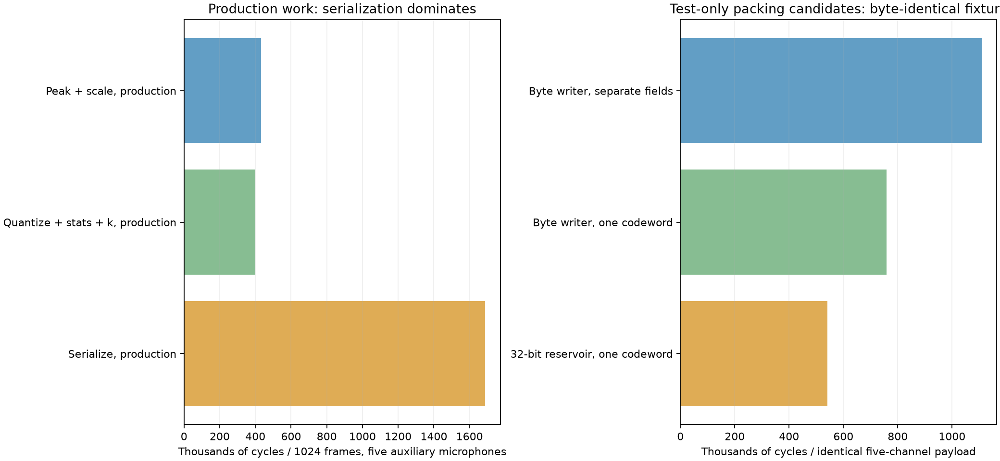

# Analysis 003: isolated CRCL loop cycle budget

**Date:** 15 October 2026 (Europe/London)  
**Target:** Raylar v1.0 / STM32U595 Cortex-M33, 144 MHz, SMPS  
**Scope:** one 1024-frame six-microphone buffer; encode MIC2–MIC6 with the cheap CRCL v2 algorithm, leave MIC1 unchanged. No microphone, FLAC, SD, GPS, radio or concurrent application tasks run.

## Findings

The existing production transform plus DATA-record serialization costs **2,522,520 cycles = 17.517 ms** for the five extra channels. A 1024-frame block at 16 kHz spans 64 ms, so this isolated workload consumes **27.4%** of the nominal core budget. This is a cycle-derived compute duty estimate, not a measured application utilization or energy figure. Input-buffer copying and the optional high-pass filter are outside that total.

Production serialization costs **1,688,225 cycles (66.9%)**; the production transform costs **834,035 cycles (33.1%)**. Rice-k estimation and scale selection each cost only a few hundred cycles across five channels. The CRCL header itself is also only a few hundred cycles. The main opportunities are the resumable transform’s inner loop and Rice bit emission, rather than parameter calculations or container metadata stores.

Test-only packing kernels produced byte-identical output: combining Rice unary/remainder fields into one codeword saves **31.6%** against the isolated byte-writer baseline; using a 32-bit reservoir with that codeword saves **51.1%** (2.05× faster). These are isolated packing comparisons, **not measured end-to-end speedups**, and the reservoir prototype has a narrower capacity-checking contract than production. No production codec behavior was changed.



## Fixture and measurement method

The fixture is a deterministic 500 Hz sinusoid generated from a fixed 32-entry Q15 table at 16 kHz, plus uniform integer pseudonoise −128…127 counts. For channels 1…6 the amplitudes are 20,000…25,000 counts and the table phase offset is two samples per channel. A single xorshift32 generator, seed `0x12345678`, advances once per interleaved scalar sample. Generation, fixture validation and data reset/copy for destructive stages occur outside timed spans. The explicit copy benchmark is the exception: that row deliberately measures copying.

The production configuration is 1024 frames, signed 10-bit target, minimum shift 6, independent temporal prediction, estimated Rice k, and no CRC or SHA. All five channels select shift 6 and k=6 on this fixture. The resulting DATA record is **5183 bytes**, including an 88-byte header and five byte-padded payloads of 989, 1008, 1024, 1034 and 1040 bytes. The payload averages 7.96 bits per auxiliary-channel sample; fixed 10-bit packing would take 6400 payload bytes. This sinusoid is a reproducible profiling input, not a representative outdoor compression corpus or a worst-case test.

Canonical interleaved little-endian i32 fixture SHA-256: `1079dbcb07850ea2a57e85b7d25a633208c9b356c66615fe8a9de1b8b1d42354`. The target reports FNV-1a32 `431565294`; the independent host generator reproduces that identity, shifts, k values and payload lengths. The [raw fixture](analysis003/fixture.i32le) and [parameters](analysis003/fixture.json) are saved.

The dedicated synchronous binary initializes the normal 144 MHz clock tree and SMPS, enables DWT CYCCNT, then masks interrupts. It starts no executor or acquisition/storage tasks. The heap remains uninitialized; benchmark buffers are static. Each row gets eight warm-ups and 129 measured runs. Input/output are passed through `black_box` and compiler fences prevent reordering across timestamps. Logging, sorting, preparation and byte comparisons occur outside the measured region. Normal stage probes compile away; there are no per-sample profiling calls in the production path.

Tables use **raw median cycles / batch**, without subtracting overhead. The empty call/timer baseline is 68 cycles. Scale and k rows batch 256 sets of five parameter calculations per span, then divide by 256. The split production-pass rows accumulate five DWT spans; their small instrumentation overhead is retained. Raw min/median/p90/max counts are in [cycles.csv](analysis003/cycles.csv) and [cycles.json](analysis003/cycles.json).

Two separate runs of the **same ELF** produced a maximum median difference of **0 cycles**; within-run maxima differ from medians by at most a few cycles. An earlier build with a different code layout measured the whole loop at 2.583 million cycles (~2.4% higher). Do not treat deterministic same-image timing as a guarantee across code layout, memory/cache conditions or different input distributions. Defmt timestamps are not used: the Embassy time driver cannot maintain its normal overflow accounting while interrupts are masked. DWT spans are short enough to avoid a full counter wrap (about 29.8 s at 144 MHz).

## Production totals

All rows below cover five auxiliary microphones, each with 1024 samples. “Per channel” is the five-channel average, not an independently timed mono encoder. The production serializer row includes creating an Encoder and ready Transform shell; sample transformation and input copying are excluded. The total row measures the real Transform and Encoder::data API together, with 256 scalar work items per advance and no async yields.

| Production measurement | Cycles / block | ms / block | Cycles / channel-block |
|---|---:|---:|---:|
| Production peak/scale passes (five spans) | 430,863 | 2.992 | 86,172.6 |
| Production quantize/stats/k passes (five spans) | 400,253 | 2.780 | 80,050.6 |
| Production Transform, unlimited budget | 830,214 | 5.765 | 166,042.8 |
| Production Transform, budget 256 | 834,035 | 5.792 | 166,807.0 |
| Production Encoder::data | 1,688,225 | 11.724 | 337,645.0 |
| Production Transform + Encoder::data, budget 256 | 2,522,520 | 17.517 | 504,504.0 |

The split peak and quantization passes are measured by advancing exactly 1024 work items at each phase boundary. Peak includes range checking and selecting the shift; quantization includes temporal differences, folding, residual sum, and k selection. Their sum is close to the unsplit transform but is a separately instrumented measurement. **Do not add these children to the transform parent.** Likewise, serialization already includes residual recomputation, Rice writing, padding and header/descriptor stores.

## Basic action costs

These standalone kernels separate arithmetic and packing mechanisms. They share the same fixture, strided six-channel layout where relevant, and encoder crate optimization level. Some use precomputed diagnostic arrays to isolate one action; those arrays are **not a proposed production memory requirement**. Independent kernels have different bounds-checking, specialization, register allocation and unrolling opportunities, so their costs do not add up to the production state machine.

| Action | Cycles / five-channel block | ms / block | Cycles / 1024-sample channel |
|---|---:|---:|---:|
| Optional first-order HPF | 46,194.0 | 0.3208 | 9,238.8 |
| Peak scan + range validation | 83,748.0 | 0.5816 | 16,749.6 |
| Select power-of-two scale (CLZ) | 289.4 | 0.0020 | 57.9 |
| Shift/truncate in place (comparison only) | 34,615.0 | 0.2404 | 6,923.0 |
| Round and quantize in place | 43,859.0 | 0.3046 | 8,771.8 |
| Temporal first difference → diagnostic buffer | 32,746.0 | 0.2274 | 6,549.2 |
| Sum already-folded residuals | 21,965.0 | 0.1525 | 4,393.0 |
| Fold + sum precomputed residuals | 39,028.0 | 0.2710 | 7,805.6 |
| Estimate Rice k (division + CLZ) | 201.5 | 0.0014 | 40.3 |
| Fused quantization + delta + fold + sum | 78,740.0 | 0.5468 | 15,748.0 |
| Current byte writer, pre-folded input | 1,109,182.0 | 7.7027 | 221,836.4 |
| Single codeword → current byte writer | 759,061.0 | 5.2713 | 151,812.2 |
| Single codeword → 32-bit reservoir | 541,886.0 | 3.7631 | 108,377.2 |
| Specialized temporal payload → byte writer | 1,124,527.0 | 7.8092 | 224,905.4 |

| Data movement / container action | Cycles | ms |
|---|---:|---:|
| Copy 1024 × 6 i32 values | 38,587 | 0.2680 |
| CRCL DATA header + descriptors only | 308 | 0.0021 |
| Header + copy existing payload (diagnostic) | 8,481 | 0.0589 |

The plain shift row is included to distinguish truncation from the current rounded quantizer; truncation is **not** a suggested silent codec change. The optional HPF is also **not** in the current encoder. The header-only kernel writes the equivalent 88-byte v2 DATA header/descriptors with an existing payload; it is not an invocation of the entire production serializer. Header + copy is an artificial staging comparison: production writes payload directly into the record buffer and does not perform this extra copy. No SD write is measured here.

## Pipeline pseudocode and optimization opportunities

The following uses native signed i32 PCM arithmetic. No sample needs promotion to i64. Counter/format fields may be 64-bit, as required by CRCL. Arithmetic headroom follows the encoder’s validated PCM bound; a future filter must preserve an explicit range guarantee. MIC1 is skipped in every transform.

### A. Optional first-order high-pass filter

This diagnostic estimates the cost of a cheap DC blocker (approximately 10 Hz corner at 16 kHz). It uses no multiply or divide. It is separate from temporal prediction, and adding it would change reconstructed audio/phase and require a documented format/calibration policy. Filter state is two i32 values per channel; a real stream must preserve it across blocks. The timing fixture starts those states at zero each run.

```text
for channel in MIC2..MIC6:
    for x in this channel, striding by 6:
        y = x - previous_x + previous_y - (previous_y >> 8)
        previous_x = x
        previous_y = y
        overwrite sample with y
```

### B. Peak scan and scale selection

```text
for channel in MIC2..MIC6:
    peak = 0
    for x in channel:
        reject x outside configured bounded PCM range
        peak = max(peak, abs(x))
    shift = max(0, bit_length(peak) - (bits - 1))
    if shift != 0 and ((peak + 2^(shift-1)) >> shift) > 2^(bits-1)-1:
        shift += 1
    shift = max(shift, 6)
```

The shift decision is already CLZ-based and cheap. Preserve rounding-headroom checks and the per-channel peak. The production peak pass is substantially slower than the simple scanning kernel, so move the phase decision, cursor updates and slice/budget checks outside a bounded inner chunk where possible. If a future streaming input copy already touches every scalar value, peak detection could be fused into that traversal without adding a sample buffer. That is a future experiment, not a measured saving in this report.

### C. In-place quantization, temporal residual and sum

```text
half = 0 if shift == 0 else 2^(shift-1)
previous_q = 0
sum_folded = 0
for n in 0..1023:
    q = (pcm[n, channel] + half) >> shift
    pcm[n, channel] = q
    if n > 0:
        residual = q - previous_q
        u = 2*residual if residual >= 0 else -2*residual - 1
        sum_folded += u
    previous_q = q
```

This is already one fused production pass: rounding, storing q, first difference, fold and sum. It stores neither residual nor folded arrays. The predictor restarts at each block; the first q is saved explicitly as a 10-bit warm-up. Scale and six-bit minimum are combined into one absolute shift, **not applied successively**.

The standalone temporal-delta row writes a diagnostic residual array; the fold/sum row then reads that array; the sum-only row reads pre-folded u. They show individual mechanisms but should not replace the fused production loop with extra passes or allocations. The isolated fused kernel demonstrates that holding previous/sum/offset/shift in local registers and handling a contiguous work chunk has much more headroom than changing the arithmetic formula.

### D. Rice parameter estimate

```text
count = frames - 1
if sum_folded == 0 or count == 0:
    k = 0
else:
    mean = ceil(sum_folded / count)
    k = floor(log2(mean))          # CLZ
```

Only one integer division and CLZ occur per channel-block. There is no histogram or candidate-k search. Keep dynamic count handling for partial final blocks. Optimizing this step has little effect on the full budget. The compiler already emits the residual fold as a shift/XOR sequence in the inspected production hot path, so merely rewriting the source fold into a branchless expression is unlikely to be the principal win.

### E. Current Rice bit emission

```text
write_signed(q[0], bits=10)
previous_q = q[0]
for n in 1..1023:
    residual = q[n] - previous_q
    previous_q = q[n]
    u = fold_signed(residual)
    quotient = u >> k
    remainder = u & (2^k - 1)
    write_zero_bits(quotient)
    write_bits(1, 1)
    write_bits(remainder, k)
pad_with_zero_bits_to_next_byte()
```

The residual is recomputed from stored q during serialization. That avoids a residual scratch buffer. The current bit writer splits fields at byte boundaries, resets fresh bytes, masks/shifts fragments, checks capacity, and updates its bit position. Unary coding invokes write repeatedly in chunks of at most 32 zero bits, plus a stop-bit write; the remainder invokes write again. Generated assembly confirms an out-of-line unary call in Encoder::data as well as runtime representation dispatch and bounds checks.

### F. Tested single-codeword and word-reservoir candidates

```text
length = quotient + 1 + k
code = (1 << k) | remainder       # leading unary zeros are implicit
if length <= 32:
    append_low_bits(code, length) # one append, not three writes
else:
    use_generic_unary_and_remainder_path()
```

For the 32-bit reservoir, the live bits occupy the high end of a u32. Appending takes the minimum of remaining codeword width and free reservoir bits; a full word is stored in big-endian/MSB order. The final partial word writes only ceil(used/8) bytes with zero padding. No u64 accumulator is needed.

```text
while remaining_code_bits > 0:
    take = min(remaining_code_bits, 32 - used)
    fragment = next_high_bits_of_codeword(take)
    reservoir |= fragment << (32 - used - take)
    used += take
    remaining_code_bits -= take
    if used == 32:
        store_4_bytes_msb_first(reservoir)
        used = 0
        reservoir = 0
```

The single-codeword byte-writer candidate retains the actual checked Bits implementation. The reservoir candidate retains Rust slice bounds checks but assumes the record capacity was prevalidated and omits the production writer’s checked_add and per-field capacity errors. Its measured improvement combines fewer/larger stores, reduced field overhead and that narrower contract. Do not attribute all of it to 32-bit stores. Production adoption needs a once-per-channel/per-record capacity proof, long-unary fallback, k=0, partial blocks, overflow handling and unchanged error behavior. A byte-safe output path is needed because channel payloads start at arbitrary byte offsets; a “word reservoir” does not automatically guarantee aligned u32 SRAM stores. Inspect the final generated instructions after integration.

### G. Small-residual lookup: proposed, not measured

```text
if folded_residual < TABLE_SIZE:
    (code, length) = table[k][folded_residual]
    append_low_bits(code, length)
else:
    compute code and length normally
```

On this fixture 29.3% of folded residuals are <64, 75.1% <128 and 100.0% <256 (maximum 160). A fixed-k=6 table can pack the code/length into 16-bit entries: 256 entries cost 512 bytes. General support for all selected k values, flash placement versus SRAM, fallback branches and table-build cost change the tradeoff. The one-codeword arithmetic is only shifts/masks/adds, so lookup is lower priority than removing repeated writer calls and per-sample state work. There is **no measured lookup speedup** in this report.

### H. CRCL record assembly

```text
reserve and zero 88 header bytes
for channel in MIC2..MIC6:
    write descriptor: channel_id, temporal_mode, k, absolute_shift
    emit Rice payload directly into output at current position
    zero-pad channel to byte boundary
    write descriptor.payload_bytes
write DATA magic/kind/header_size/total_size/sequence/frame_offset/frame_count
return complete record slice
```

No CRC or digest is appended in v2. Record assembly should keep payload emission in place and avoid a staging copy. The header-only diagnostic takes less than 0.0022 ms; even its artificial full-payload copy is below 0.06 ms. “CRCL packing” in earlier inclusive profiles mostly reflects Rice emission, not these descriptor stores. SD buffering and card write bursts belong to a different measurement and are intentionally absent here.

## Optimization order

1. **Specialize the v2 temporal payload path and combine each common Rice symbol into one append.** Retain the generic long-code fallback and exact padding. This has a measured byte-identical packing benefit using the existing checked writer.
2. **Prototype a u32 reservoir with record-level capacity validation.** Compare complete Encoder::data and Transform+data after integration; keep error behavior and arbitrary payload alignment. The current result is a useful upper-bound experiment, not a production patch.
3. **Refactor advance_cheap around bounded inner chunks.** Keep sample cursor, previous q, sum and shift in locals; separate peak and quantization loops so each sample does not re-enter generic phase logic. Persist scalar state at chunk boundaries to retain responsiveness and in-place memory behavior.
4. **Retain fused arithmetic; consider interleaved peak collection while loading the existing buffer.** Avoid residual/LUT sample workspaces. Measure the full path because independent kernel sums overstate precision.
5. **Evaluate lookup only after these changes.** Parameter calculations and the 88-byte header are already negligible.

Changing Transform::advance from budget 256 to unlimited changes this fixture’s transform by only 3,821 cycles (0.46%). Simply removing cooperative call boundaries does not explain the much larger gap between the stateful transform and the specialized arithmetic kernels. That gap includes generic state management, bounds/phase/budget checks, specialization and compiler code generation; it is not a direct isolated measurement of one branch.

## Validation, artifacts and reproduction

Target-side checks compare each candidate payload byte-for-byte with production Encoder::data, compare complete header+payload records, verify quantized samples equal the production Transform, and verify MIC1 is unchanged. The optional HPF and shift-only truncation rows are intentionally separate arithmetic experiments. Ten desktop tests pass with the benchmark feature enabled, including reservoir writes of widths 0…32 across word boundaries, deterministic fixture/payload equivalence and existing encoder tests. Neither benchmark buffers nor candidate routines are included in normal firmware builds.

Tested ELF SHA-256: `71f1ad53d2400061788ae0b77097bfd1b26d0d9708e90d6b7a4a98b95b3f3496`. Build: `935162c4908d4a09d3bc4603df1177e800000565-dirty`, release, rustc 1.96.0 (ac68faa20 2026-05-25); encoder crate opt-level=3, workspace opt-level="s", LTO disabled, one codegen unit. Original code and all measurements use the standard release settings rather than applying a new optimization profile. See [build identity](analysis003/benchmark-build.json), [first run](analysis003/target-run1.log), [repeat](analysis003/target-run2.log), and [hot-function assembly](analysis003/hot-functions.asm).

The board is left running the completed benchmark, idle after PASS; acquisition and SD recording are not active. No Aardwolf configuration or encoding algorithm was changed.

Build, flash and collect a fresh run:

```powershell
rtk proxy powershell -ExecutionPolicy Bypass -File scripts/run_crcl_loop_benchmark.ps1
# Logs are saved in the session directory printed by firmware.ps1.
# Repeat the same ELF without rebuilding:
rtk proxy powershell -ExecutionPolicy Bypass -File scripts/firmware.ps1 -Package service-test-crclencoder -Bin crcl-loop-benchmark -NoBuild -MonitorSeconds 30 -Until 'CRCL LOOP BENCH PASS'
```

Regenerate the report from the saved evidence without a board:

```powershell
rtk proxy python scripts/crcl_loop_report.py --log docs/audio/multichannel/analysis003/target-run1.log --repeat-log docs/audio/multichannel/analysis003/target-run2.log
rtk cargo test -p raylar-crcl-encoder-service --features loop-benchmark --target x86_64-pc-windows-msvc
```

For new sessions, pass their `target.log` paths and `--build-record firmware-builds/service-test-crclencoder.json` to the report script. Source: [target entrypoint](../../../servicetests/crclencoder/loop_benchmark.rs), [diagnostic kernels](../../../crates/services/crclencoder/src/benchmark.rs), [runner](../../../scripts/run_crcl_loop_benchmark.ps1), [report generator](../../../scripts/crcl_loop_report.py). The [artifact manifest](analysis003/manifest.json) records hashes of saved evidence and reproduction sources.
