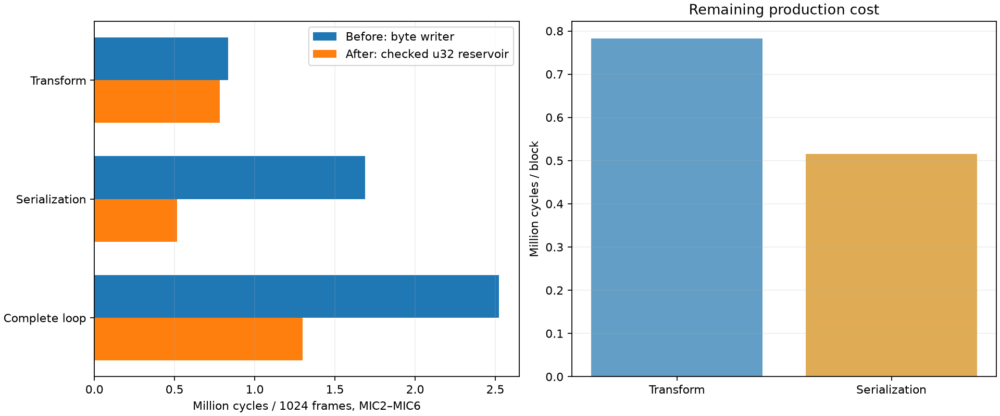

# Analysis 004: production Rice codewords and u32 reservoir

**Date:** 15 October 2026, Europe/London  
**Target:** Raylar v1.0 / STM32U595, 144 MHz, SMPS  
**Related:** [Analysis 003: baseline and stage pseudocode](analysis003.md)

Production CRCL now emits common Rice codes with one append into a capacity-checked **u32 MSB-first reservoir**. On the same deterministic 1024-frame fixture, complete five-channel encoding falls from **2,522,520 to 1,298,751 cycles**: **48.5% fewer cycles**, 17.517 → **9.019 ms**. Serialization falls by **69.5%**. The DATA record remains exactly 5183 bytes, with identical packed payloads, quantization, Rice k and MIC1 samples.



## Production change

The old writer visited bytes as each field was emitted. It wrote unary zeros, a stop bit and the remainder separately. The production serializer now calls `bits.rice(folded_residual, k)`. For a Rice code that fits in 32 bits, its leading zeros are implicit in the width and one append emits the whole symbol. Longer codes append zero chunks, followed by the combined stop bit and remainder.

```text
quotient = folded_residual >> k
length = checked_add(quotient, 1 + k)
reject if length exceeds remaining output capacity
remaining_capacity -= length
code = (1 << k) | (folded_residual & ((1 << k) - 1))
if length <= 32:
    append(code, length)
else:
    append quotient zero bits in chunks no larger than 32
    append(code, k + 1)
```

The append operation accepts at most 32 bits and crosses at most one reservoir boundary. It has a fast path when the field fits and a flush path when a word fills. No loop is needed for a short codeword; shifts by 32 are explicitly avoided.

```text
append(value, width):
    if width == 0: return
    free = 32 - used
    word |= (value << (32 - width)) >> used
    if width < free:
        used += width
    else:
        store_four_bytes_MSB_first(word)
        used = width - free
        word = 0 if used == 0 else value << (32 - used)

finish():
    write only ceil(used / 8) bytes of the pending word
    # Unused low bits are already zero: identical byte padding.
```

The writer tracks remaining bit capacity as scalar state, avoiding repeated output-length multiplication for each field. Every field/code checks capacity before updating state. Widths >32, invalid k, overflowing Rice length and insufficient output return errors; no unchecked pointer stores are used. Full words and tails use safe byte-slice copies, so arbitrary payload start alignment is supported. The final write contains exactly ceil(pending_bits/8) bytes; bytes after the payload remain untouched.

Only scalar writer state changes: a u32 word, pending-bit count, remaining-bit count and flushed-byte position. On the 32-bit target, the writer structure adds 12 bytes relative to the previous writer; this is not a measured whole-function stack increase. There is no heap allocation, new PCM/residual array or u64 reservoir. Existing workspace capacities remain sufficient.

Both v1 and v2 use this internal writer, including warm-ups and packed v1 samples. File versions, metadata, reference handling, scale selection, rounded quantization, temporal prediction, Rice parameter estimation, sample alignment and payload format are unchanged. Aardwolf uses the library change through its existing cheap-codec configuration.

## Re-benchmark

Measurement conditions match Analysis 003: 1024 frames × six input channels, encode MIC2–MIC6; 500 Hz table sinusoid plus seeded noise; 10-bit target, min shift 6, per-channel k=6. DWT CYCCNT measures eight warm-ups followed by 129 runs. Interrupts are masked; no acquisition, SD, GPS, radio, FLAC or executor tasks run. Input preparation and logging are outside the spans. Two complete runs of the same new ELF passed every equality check.

| Production action | Before cycles | After cycles | Before ms | After ms | Fewer cycles |
|---|---:|---:|---:|---:|---:|
| Production peak/scale passes (five spans) | 430,863 | 379,686 | 2.992 | 2.637 | 11.9% |
| Production quantize/stats/k passes (five spans) | 400,253 | 400,244 | 2.780 | 2.779 | 0.0% |
| Production Transform, unlimited budget | 830,214 | 779,028 | 5.765 | 5.410 | 6.2% |
| Production Transform, budget 256 | 834,035 | 783,172 | 5.792 | 5.439 | 6.1% |
| Production Encoder::data | 1,688,225 | 515,654 | 11.724 | 3.581 | 69.5% |
| Production Transform + Encoder::data, budget 256 | 2,522,520 | 1,298,751 | 17.517 | 9.019 | 48.5% |

All cycles cover five auxiliary channels. Raw medians include timer/call overhead (empty baseline 66 cycles); scalar rows in the full CSV divide their batched counts by 256. Split peak/quantization rows are child measurements, not costs to add to their transform parent. Maximum difference between all stage medians across the two same-image runs: **0 cycles**.

The 64 ms block budget is 9,216,000 cycles. The isolated codec’s derived duty falls from **27.4% to 14.1%**. This excludes input copy, optional filtering, reference FLAC, SD and other application work. No current or energy saving was measured.

The transform algorithm was not edited, yet its timing shifted by about 6% between images. Unchanged byte-writer and copy kernels also moved in timing. Treat these as code-layout/cache/compiler-context variation, not extra algorithmic optimizations. The before/after figures are observations on the recorded ELF images, and the whole-loop reduction includes that variation. The serialization improvement is much larger than this effect.

The legacy comparison kernels deliberately retain the frozen byte writer. Rows named `rice_bytes_pre_folded_5ch`, `rice_single_codeword_5ch` and `payload_from_quant_5ch` therefore still measure the old writer, not the new production reservoir. `rice_words_codeword_5ch` remains the original unchecked-capacity prototype. **Use `production_serialize` and `production_codec_budget256` to judge the integrated change.** The new production implementation is faster on this fixture than that original reservoir prototype because its append path avoids the generic fragment loop and its Rice path combines field handling. Microkernel and production call contexts also differ, so their timings are not additive.

## Further optimization priorities

1. **Refactor the resumable transform into bounded phase-specific inner loops.** It now accounts for 60.3% of the total. Peak/scale costs 379,686 cycles and quantize/stats/k 400,244. The standalone checked peak scan is 81,950 cycles and the fused arithmetic kernel 78,736. Keep channel/offset/previous/sum/shift in locals during a chunk, and save scalar state only at chunk boundaries. Preserve resumability, range checks, ties-to-positive-infinity rounding and zero/partial block handling. These kernel gaps show headroom; they are not a guaranteed speedup.
2. **Move invariant serialization decisions outside the sample loop.** Serialization still costs 515,654 cycles (39.7% of the total). A dedicated per-channel temporal path can handle the warm-up once and avoid generic representation dispatch for each sample. Check assembly before assuming a source expression, such as a mask or k conversion, is repeatedly evaluated.
3. **Consider peak collection while filling the existing interleaved block.** Input copy alone measures 44,723 cycles and is not included in the codec total. Combining a necessary traversal with per-channel peak statistics could avoid a separate pass, but requires careful ownership/API design and a measured full-path comparison.
4. **Defer lookup tables and parameter arithmetic.** The common Rice code is now emitted with shifts, a mask and an append. A table may replace only a few arithmetic instructions while adding loads, cache footprint and a fallback branch. Shift selection and Rice-k estimation remain a few hundred cycles across five channels. Measure any table build/storage cost and validate on quiet, tonal, noisy and transient blocks before adopting it.

No further transform or serialization-specialization changes are included in this iteration, so subsequent measurements can isolate those steps.

## Validation and saved evidence

- **13 desktop tests passed.** The frozen legacy writer is used to compare payload bytes for both CRCL versions, every representation, 6/8/10/12-bit precision, min shifts 0/6 and partial/full frame counts 1, 255, 256, 257, 1024 and 4096.
- Field-level tests compare widths 0…32 at all pending bit offsets and all four byte alignments, with nonzero-filled outputs and sentinel bytes.
- Rice tests cover k=0…31, zero/small/large residuals, the 32-/33-bit code boundary, long unary runs and u32 boundary values.
- Capacity tests cover empty/exact/tail buffers, invalid widths/k, overflowing lengths and a valid continuation after an error. Padding and bytes outside the output slice are checked.
- Both board runs preserve the fixture’s reference samples and reproduce all old byte-writer payloads and complete DATA headers exactly.
- The normal release Aardwolf build also passes; it is built but not flashed. Its [build identity](analysis004/aardwolf-build.json) is saved. The board remains on the completed isolated benchmark, idle after PASS.

The legacy byte writer is compiled only with tests or `loop-benchmark`; normal Aardwolf builds contain the new writer. Production code is in [bits.rs](../../../crates/services/crclencoder/src/bits.rs) and the [serializer call site](../../../crates/services/crclencoder/src/format.rs). The quantizer and transform were unchanged.

Benchmark ELF SHA-256: `71f912865571c614da7081f7eb94b50a4d1a12f2a1e0daca888299e2219cd71c`. [Build identity](analysis004/benchmark-build.json), [first run](analysis004/target-run1.log), [repeat](analysis004/target-run2.log), [all stage cycles](analysis004/cycles.csv), [metrics](analysis004/cycles.json), [disassembly](analysis004/hot-functions.asm) and [manifest](analysis004/manifest.json) are preserved. The historical [Analysis 003 baseline](analysis003/cycles.json) is unchanged.

```powershell
# Build, flash and profile only the CRCL loop:
rtk proxy powershell -ExecutionPolicy Bypass -File scripts/run_crcl_loop_benchmark.ps1
# Repeat without rebuilding:
rtk proxy powershell -ExecutionPolicy Bypass -File scripts/firmware.ps1 -Package service-test-crclencoder -Bin crcl-loop-benchmark -NoBuild -MonitorSeconds 30 -Until 'CRCL LOOP BENCH PASS'
# Host checks:
rtk cargo test -p raylar-crcl-encoder-service --features loop-benchmark --target x86_64-pc-windows-msvc
# Recreate this report from saved logs:
rtk proxy python scripts/crcl_reservoir_report.py --log docs/audio/multichannel/analysis004/target-run1.log --repeat-log docs/audio/multichannel/analysis004/target-run2.log
```

For fresh measurements, pass the newly printed log paths and `--build-record firmware-builds/service-test-crclencoder.json`. Use `scripts/crcl_bench_inspect.py --output docs/audio/multichannel/analysis004` to regenerate assembly from that benchmark ELF without overwriting the historical Analysis 003 evidence.
