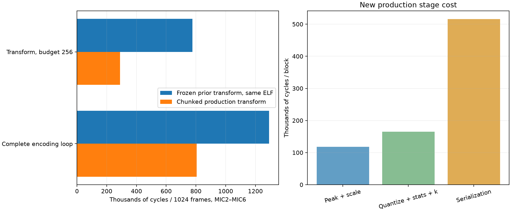

# Analysis 005: bounded production transform loops

**Date:** 15 October 2026, Europe/London  
**Target:** Raylar v1.0 / STM32U595, 144 MHz, SMPS  
**Scope:** implement recommendation 1 from [Analysis 004](analysis004.md); keep the reservoir serializer and codec semantics unchanged.

The cheap v2 transform now runs a bounded peak loop or a bounded quantization/statistics loop, keeping working state local until each chunk completes. Compared with a frozen previous transform in the **same firmware image**, its cost falls from **777,048 to 289,163 cycles** (62.8% fewer cycles). Complete encoding falls from **1,292,496 to 804,988 cycles**, **8.976 → 5.590 ms**, a **37.7% reduction**. Output remains byte-identical.



## Implementation

The old loop visited one scalar work item at a time and repeatedly accessed phase, channel, offset, shift, peak, previous q and sum through the Transform state. It checked phase completion and decremented the caller budget after each scalar sample. The new outer loop calculates one bounded interval for the current channel and phase, then uses a stride-six slice iterator for that channel. MIC1 is never selected.

```text
while budget > 0 and channel < 6:
    start = offset
    count = min(budget, frames - start)
    end = start + count
    samples = pcm[start*6 + channel : end*6], stride 6

    if phase == PEAK:
        local_peak = peak
        local_bound = max_abs_pcm
        for n, x in samples:
            if x outside [-local_bound, local_bound]:
                offset = start + n
                peak = local_peak
                return SampleOutOfRange
            local_peak = max(local_peak, abs(x))
        peak = local_peak
    else:
        local_shift = shift
        half = 0 if local_shift == 0 else 1 << (local_shift - 1)
        local_previous = previous
        local_sum = sum_folded
        for n, sample_slot in samples:
            q = (sample_slot + half) >> local_shift
            overwrite sample_slot with q
            if start + n != 0:
                local_sum += fold(q - local_previous)
            local_previous = q
        previous = local_previous
        sum_folded = local_sum

    offset = end
    budget -= count
    if end == frames:
        offset = 0
        if phase == PEAK:
            shift = max(shift_for_peak(peak, precision), min_shift)
            phase = QUANTIZE
        else:
            store channel shift, temporal mode and estimated Rice k
            move to next channel and reset scalar state
```

The caller’s budget still counts scalar visits, not frames across all channels: a full block requires 2 × 5 × frames work items. `advance(256)` therefore retains its existing work limit and call count. A call can cross a phase or channel boundary only with unused budget. A zero budget does no work; completion remains idempotent. Each chunk stores persistent state before returning.

On a range failure, the new loop commits the peak and offset of the valid prefix but leaves the rejected sample unconsumed. This matches the previous state exactly, including when an earlier channel has already been quantized. Range checks precede abs(), so i32::MIN is rejected safely. Rounding still uses one add and arithmetic shift, with ties towards positive infinity; shift-zero and the minimum-discard rule are unchanged. No u64 PCM arithmetic, heap allocation, new sample arrays or residual buffers are introduced.

The first quantized sample still has no temporal residual; subsequent samples continue from the saved previous q across chunks. Per-sample profiling keeps the same absolute sample indices and stage assignments, and normal builds compile those probes away. V1’s transform and the v1/v2 serializers were not edited in this iteration.

## Correctness checks

**15 host tests passed.** A test/benchmark-only frozen copy of the previous cheap transform provides the equivalence reference. Normal application builds exclude that copy. New checks compare all transformed PCM, every persistent scalar field, all channel descriptors, return values and complete encoded record buffers, rather than only checking successful decode.

| Coverage | Cases |
|---|---|
| Valid state/output comparisons | 867 input/configuration/budget scenarios |
| Frame counts | 1, 7, 255, 256, 257, 1023, 1024, 1025, 4096 |
| Precision / minimum shift | 6, 8, 10, 12 bits; min shift 0, 6, 30 |
| Inputs | Silence, constant, alternating extrema, deterministic noise; differing amplitudes per channel |
| Budgets | Zero, one-item, fixed 256, mixed sizes around phase boundaries, and usize::MAX |
| State comparison | After every advance, including completed calls with zero/large budgets |
| MIC1 | Alternating i32::MIN/MAX, verified unchanged after every successful advance |
| Maximum legal bound | Additional tests with max_abs_pcm=i32::MAX/2 |
| Range failures | 120 scenarios across all auxiliary channels and sample positions 0, 1, 112, 113, 255, 256 |
| Failure values | Values just outside each configured bound, i32::MIN and i32::MAX |
| Failure continuation | Exact cursor/peak/state retained; zero-budget and repeated failing calls compared |

Existing payload tests against the frozen byte writer, Rice reservoir boundary/capacity tests and codec roundtrips also pass. Both hardware runs preserve MIC1 and reproduce the original 5183-byte DATA record, shifts=[6,6,6,6,6], k=[6,6,6,6,6] and payload byte counts [989,1008,1024,1034,1040]. The normal Aardwolf release build passes.

## Hardware timing

The same deterministic 1024-frame sinusoid/noise fixture and measurement conditions from Analyses 003/004 are retained: 16 kHz, five auxiliary channels, 10-bit target, min shift 6, 144 MHz/SMPS, eight warm-ups and 129 measured runs per row. DWT CYCCNT is used with interrupts masked. No microphone capture, SD, GPS, FLAC, radio or executor tasks run during measurement. Preparation, logging and equality checks are outside measured spans. Raw medians include timer/call overhead; split phases are children of the transform, not costs to add to it.

### Same-image A/B comparison

| Measurement | Previous transform control | Chunked production | Previous ms | New ms | Fewer cycles |
|---|---:|---:|---:|---:|---:|
| Transform, budget 256 | 777,048 | 289,163 | 5.396 | 2.008 | 62.8% |
| Complete loop, budget 256 | 1,292,496 | 804,988 | 8.976 | 5.590 | 37.7% |

Both controls share the same fixture, reset method, current reservoir serializer, configuration and image as the production measurements. The frozen control calls its internal cheap transform directly; production goes through the normal `Transform::advance` dispatch. Normal profiling probes compile away. This control reduces between-build code-layout variation; the two functions still occupy different addresses and may have different compiler/caching effects. The previous control closely matches the independently archived pre-change result below.

### Historical production comparison

| Action | Analysis 004 cycles | New cycles | New ms |
|---|---:|---:|---:|
| Production peak/scale passes (five spans) | 379,686 | 117,840 | 0.818 |
| Production quantize/stats/k passes (five spans) | 400,244 | 165,254 | 1.148 |
| Production Transform, unlimited budget | 779,028 | 282,324 | 1.961 |
| Production Transform, budget 256 | 783,172 | 289,163 | 2.008 |
| Production Encoder::data | 515,654 | 515,678 | 3.581 |
| Production Transform + Encoder::data, budget 256 | 1,298,751 | 804,988 | 5.590 |

Against the archived prior production image, the transform is **63.1%** cheaper and the full loop **38.0%** cheaper. Serialization is essentially unchanged (515,654 → 515,678 cycles), making the attribution clearer than in the previous packing iteration.

Two separate runs of this exact ELF reproduced **all stage medians**, maximum median difference 0 cycles. Raw min/median/p90/max values and all primitive/control rows are saved in [cycles.csv](analysis005/cycles.csv) and [cycles.json](analysis005/cycles.json). Historical evidence remains unchanged.

The 64 ms capture-block budget is 9,216,000 cycles. The complete isolated codec consumes **8.7%** of that budget, compared with 14.0% for the same-image old transform. These percentages are derived compute duty, not measured application utilization or current. Input copy, optional filtering, reference FLAC, storage and other tasks remain excluded.

## Remaining optimization avenues

1. **Specialize the temporal serialization loop next.** Serialization is now 64.1% of the total (515,678 cycles), with the transform 35.9%. Consider moving representation selection outside each sample loop and handling the first signed warm-up separately, while preserving v1 representations and the current checked reservoir. Inspect assembly before assuming source-level invariants still execute repeatedly.
2. **Compare alternate safe strided loops and warm-up peeling inside quantization.** The chunked peak/scale phases cost 117,840 cycles, and quantize/stats/k 165,254. Specialized standalone kernels remain cheaper, but have different bounds and compiler context. The current quantization loop still distinguishes the first sample inside its inner loop; a separate first-sample case may help if not already peeled by the compiler. Any further change must pass the same state/error equivalence matrix.
3. **Peak collection during input copy remains an API-level experiment.** It could avoid a traversal of the same interleaved data, but was deliberately excluded from this narrowly scoped change.
4. **Keep cooperative limits and avoid extra buffers.** Increasing the budget to unlimited saves only a small fraction of the new transform cost and would change scheduling responsiveness. Rice-k/scale arithmetic and container header writes remain low priority; lookup tables still need evidence of a net benefit.

## Artifacts and reproduction

Benchmark ELF SHA-256: `9c327bfabe4a4f568ec3ad4b151f9e5f0251b58291283032fe1ef8da8aceda5e`. See [build identity](analysis005/benchmark-build.json), [Aardwolf build identity](analysis005/aardwolf-build.json), [first run](analysis005/target-run1.log), [repeat](analysis005/target-run2.log), [assembly](analysis005/hot-functions.asm), and [artifact manifest](analysis005/manifest.json). The original fixture is in [Analysis 003](analysis003/fixture.json).

Source: [chunked transform](../../../crates/services/crclencoder/src/cheap.rs), [frozen reference](../../../crates/services/crclencoder/src/cheap_reference.rs), [state/error equivalence tests](../../../crates/services/crclencoder/src/cheap_tests.rs), [benchmark controls](../../../crates/services/crclencoder/src/benchmark.rs). The board remains idle on the completed benchmark. Aardwolf is built with the new production transform but has not been flashed.

```powershell
rtk cargo test -p raylar-crcl-encoder-service --features loop-benchmark --target x86_64-pc-windows-msvc
rtk proxy powershell -ExecutionPolicy Bypass -File scripts/run_crcl_loop_benchmark.ps1
# Repeat the same ELF:
rtk proxy powershell -ExecutionPolicy Bypass -File scripts/firmware.ps1 -Package service-test-crclencoder -Bin crcl-loop-benchmark -NoBuild -MonitorSeconds 30 -Until 'CRCL LOOP BENCH PASS'
# Regenerate the report from archived logs, without a board:
rtk proxy python scripts/crcl_transform_report.py --log docs/audio/multichannel/analysis005/target-run1.log --repeat-log docs/audio/multichannel/analysis005/target-run2.log
```

For fresh measurements pass the new log paths plus `--build-record firmware-builds/service-test-crclencoder.json` and `--aardwolf-build-record firmware-builds/aardwolf.json`. Save assembly with `scripts/crcl_bench_inspect.py --output docs/audio/multichannel/analysis005`. The shared log parser now accepts explicit extra stage names, while historical report scripts continue to validate their original stage sets.
