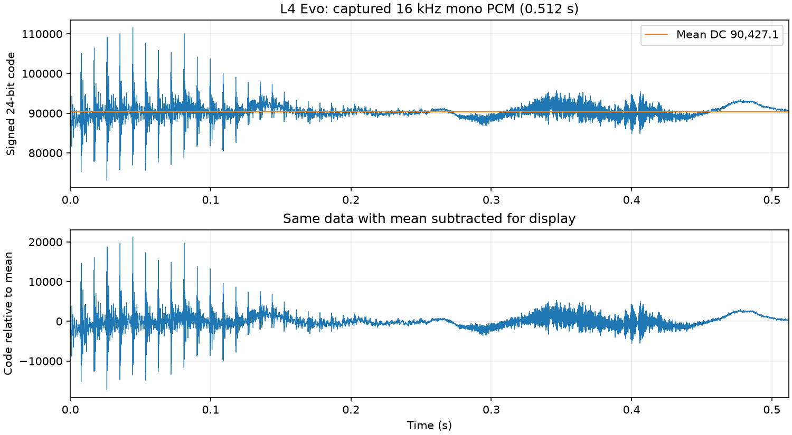

# L4 mono audio bench evidence

Validation date: 2026-11-24. Configuration and acceptance are defined by
[ADR-L4-010](../../../SpecAndDesign/Platform/L4/ADR-L4-010-dfsdm-mono-audio.md).

**Final hardware result: PASS.** The connected Evo STM32L476RG was programmed
and verified through ST-Link V2 at 100 kHz SWD. The
[full target log](hardware-final.log) and [image identity](hardware-final.json)
record the actual run. The tested ELF SHA-256 is
`1b4e3f906013bd8fd8ee29b5f17ef9a278f0f7308bc3de7ef6ae51c0b03e1451`.

| Check | Observed result |
| --- | --- |
| Clock/filter | 80 MHz system clock, PC2 AF6 PDM clock divided by 25; Sinc5/FOSR50/IOSR4, right shift 8. Nominal output 16000 samples/s. |
| Input | PB12 AF6, DFSDM channel 1 rising edge, regular filter 0. One phase of the M1/M5 data pair. |
| DMA | DMA1 channel 4/request 0, circular 1024-word buffer; 970 half and 969 full completion IRQs. Zero DMA errors, service deadline failures or ring overwrites. |
| Duration | 992768 samples including 32768 warm-up samples. Exactly 960000 samples qualified over sixty nominal seconds. |
| Cadence | First-to-last completion elapsed 62016000 µs, exactly the expected integer-divider interval. TIM5 and DFSDM share the HSE; this is not a GPS-referenced frequency measurement. |
| Filter flags | Final ISR `0x00fd4000`: regular conversion active and unused-input clock flags; no selected-channel clock absence, regular overrun or injected overrun. |
| PCM | Qualified minimum 73134, maximum 111591, no signed-24-bit rail clipping, low PCM byte variation `0xff`. All 960000 qualified values were positive because of microphone DC offset. |
| Shared producer | Every block passed through the unchanged AudioSource and an exact-value/position reader check; zero drops and reader overruns. |
| Processing | Maximum measured block processing 882 µs, versus a 32000 µs half period. This task measurement excludes DMA wait and periodic progress formatting; it is not total CPU utilization. |
| Memory | 30128 flash bytes; 44944 SRAM1 static bytes; 53360 bytes available for CPU stack/unused space, including the required 24 KiB link-time gap. Initial MSP `0x20018000`; SRAM2 unused. No runtime stack watermark measured. |

DFSDM and DMA stop before the final snapshot/PASS messages, approximately
62.15 seconds after boot. Blue then blinks at 1 Hz; red and green stay off.
Reset repeats the finite test. SD and GPS are unused and the card is untouched.

The [standalone start](standalone-start.json) and
[completion](standalone-completion.json) record an additional reset run without
an RTT monitor or memory attachment during acquisition. Before reset the
descriptor was zero; afterward it became ready with a new audio hash. This
provides completion evidence independently of the attached RTT run. The board
is left running this image.

## Retained audio

The [raw DMA words](snapshot-raw.bin) contain 8192 little endian 32-bit register
values, starting at sample index 301568 (18.848 nominal seconds after the first
sample). The [completion descriptor](snapshot-meta.bin) and
[export report](snapshot.json) confirm raw FNV-1a32 `ceca1f59`, matching the
firmware's hash after the producer stopped. All pending/reserved bits were zero;
L476 RDATACH is unimplemented and returned zero.

The [24-bit WAV](snapshot-pcm24.wav) is mono, 16000 Hz and 0.512 seconds long.
It contains the arithmetic-right-shifted signed samples, packed into three bytes
each, with original amplitude/DC and no normalization. The export was performed
on the host using [export_audio.py](../export_audio.py), with no reset or card I/O.
The report records the exact SWD commands and hashes. Empty `.bin.log` files
mean the corresponding probe read completed without textual diagnostics.

The burst contains 4374 distinct sample values and all 256 low PCM byte values.
Its mean DC is 90427.06 codes; AC RMS around that mean is 2020.05 codes
(-72.37 dBFS), with no clipped samples. These describe this ambient capture;
they are not microphone SNR, calibrated SPL or effective-bit measurements.

The lower plot subtracts the mean for display only. Raw data and the WAV retain
the offset. The waveform contains changing transients, but no controlled
acoustic stimulus or individual-microphone identity test was performed.
The 24-bit representation is verified; 24 effective acoustic bits, frequency
response, sensitivity, all microphones, long recordings and concurrent SD/GPS
operation are outside this smoke's coverage.

## Reproducibility and development history

[build.json](build.json) records source/tool identity, build command, lockfile
hash and memory layout. [firmware.zip](firmware.zip) retains the exact tested
ELF/BIN, changed build inputs, lockfile, generated memory map and feature graph.
Verify its [SHA-256](firmware.zip.sha256). Rebuilding uses the recorded base
repository plus those changes; the archive is not a complete checkout.

Two development runs are retained separately. `hardware-initial` stopped on
an incorrect expectation that RDATACH would report channel 1. ST errata
ES0250 2.12.1 confirms that this status field is unimplemented on L476. Its ELF
is retained as `development/initial.elf` in the archive. `hardware-dc-offset`
completed streaming but rejected valid DC-biased audio because the initial
acceptance expected zero crossings. The final image checks varying PCM/low
bits, preserves raw offset and selects its burst using approximate AC power.
`hardware-final` is the fully logged qualification for the archived final
firmware and WAV; the additional standalone checks use that same image.

The extra reset checks exposed two debugger effects. The first
[reset attempt](standalone-reset.json) left the
[old descriptor](reset-caught-descriptor.json) unchanged: probe-rs reset vector
catch can halt before startup clears RAM. Starting with `--no-catch-reset`
cleared this condition. A subsequent
[mid-capture memory inspection](midcapture-attach-start.json) observed cleared
RAM, but [then hit a DMA overwrite](standalone-debug.log) at 0.247 seconds:
attaching for memory reads can pause the CPU while the producer keeps running.
These attempts are not counted as standalone passes. The final reset run
avoids all memory attachment until after the capture interval. The original
raw/WAV files remain from the fully logged `hardware-final` run.

U5 build, effective-feature, ELF and portable-test comparisons are recorded in
[regression.json](regression.json), with full [build logs](u5-build-logs.zip),
[portable host suites](host-portable.log), [integration004](host-integration004.log)
and [five native audio checks](host-mono-audio.log). No existing test expectations
were edited. U5 hardware and a non-Windows host were not exercised.

All 61 U5 firmware packages built successfully. All 66 saved U5 ELF files and
nine effective feature trees (five U5, four earlier L4 leaves) are unchanged.
Root default members are identical. Portable suites report 203 passed and the
same five known failures as 04; integration004 adds thirteen passing checks.
All five native mono audio checks pass. [Final checks](checks.json) also verify
the wrong-target guard, formatting, document links and archive/source hashes.
